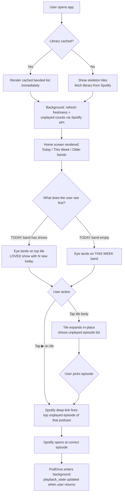
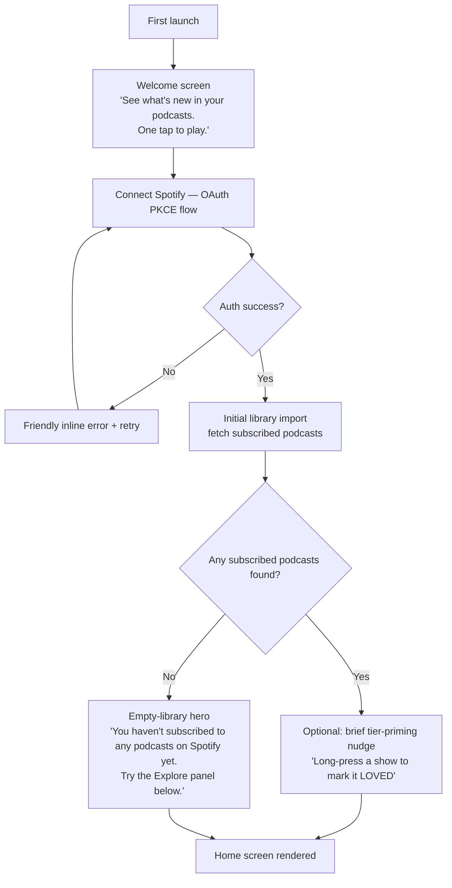
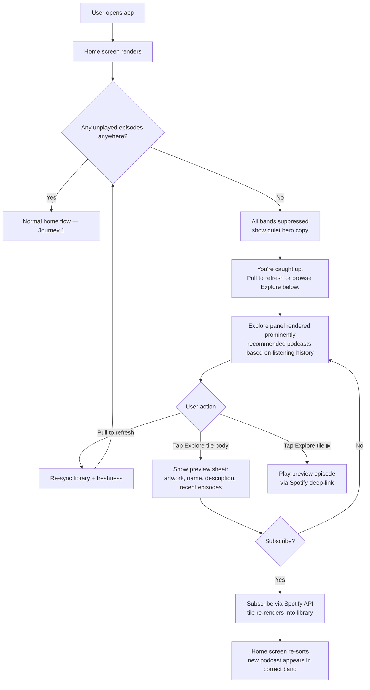
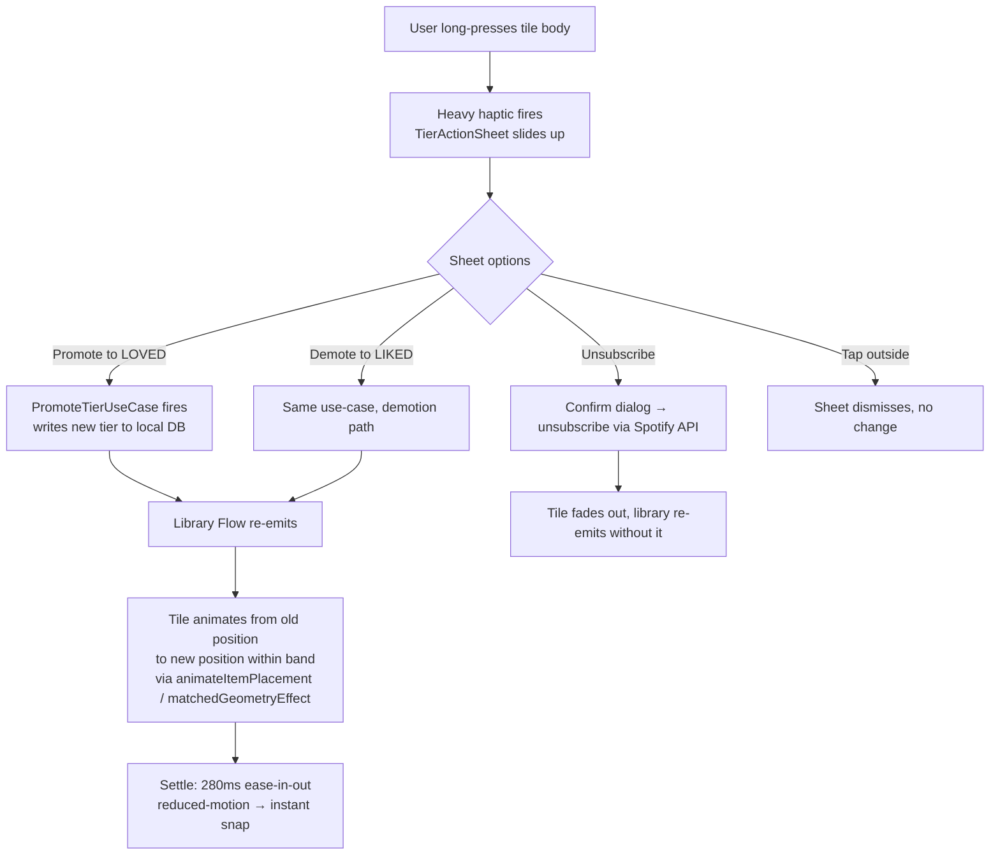

# UX Design Specification PodDrive

**Author:** Dimitrios.dimitrelos
**Date:** 2026-04-24 (revision of 2026-03-19 spec)
**Status:** Revised post-pivot per Sprint Change Proposal 2026-04-24

---

> **Revision notice.** This specification replaces the 2026-03-19 drive-session-centric spec following an approved Sprint Change Proposal (2026-04-24). The product has pivoted to a podcast-list-centric home screen UX. Drive Mode + AI briefing components are **deferred to the Vision phase** — the code remains in the codebase as scaffolding and is labelled "deferred" throughout this spec, **not** deleted. When this spec references drive-mode components, it does so to describe their current non-MVP status, not to design for them.

## Executive Summary

### Project Vision

PodDrive is a mobile app (iOS + Android) that makes "what's new and worth playing in my Spotify podcast library" obvious at a glance, and plays it in one tap. The home screen *is* the product: a fresh-sorted list of subscribed podcasts, visually banded by how recently they have new unplayed episodes, with a prominent quick-play control on every tile. PodDrive operates as a purposeful layer on top of Spotify's public API — it curates and surfaces; Spotify still plays the audio.

The app is designed to be **driver-friendly as a universal baseline** (glanceable hierarchy, large tap targets, high contrast) so it works safely if the user happens to be stationary in a car — but it is **no longer a voice-first drive-session product**. Bluetooth-triggered auto-start, AI voice briefing, and drive-mode-locked navigation are deferred to the Vision phase and retained as scaffolding in the codebase.

### Target Users

**Primary — Dimitrios (the canonical user):**
A mid-to-advanced smartphone user who subscribes to 20–50 podcasts on Spotify, listens across mixed contexts (commuting, walking, at a desk, occasionally in a car), and is frustrated that Spotify's podcast surface makes it hard to see at a glance which shows have genuinely new episodes worth playing right now. Tech-comfortable, not a power user. Expects the app to open to a useful home screen, not a navigation puzzle.

**Secondary — The Lapsed Listener:**
A user with a long Spotify podcast subscription list who has fallen behind, feels guilty about the backlog, and wants a tool that honestly surfaces what's worth catching up on — without algorithmic opacity. Values curation, warmth, and the sense that the app is on their side rather than engagement-maximising.

**User profile:** Aged 25–45, comfortable with app integrations. Not likely to read documentation — the app must be self-evident from first open. Primary session length: 30 seconds to 3 minutes (pick something, tap play, leave). This is not a "dwell in the app" product.

### Key Design Challenges

1. **Glanceable hierarchy without a dashboard feel** — the home screen must let a user find "what's worth playing right now" in under two seconds across 20–50 podcasts, without reducing to a dense list or a content-farm recommendation feed. The three-band freshness sort (Today / This Week / Older) plus in-tier LOVED/LIKED ordering is the visual backbone.
2. **Tap-target boundary on the `PodcastTile`** — each tile has two distinct actions: a prominent quick-play ▶ that starts the top unplayed episode instantly, and a tile-body tap that expands the tile to reveal its episode list. These must feel unambiguous to the finger and the eye, with no accidental cross-triggers. Solved via an elevated floating ▶ with its own hit-box, haptic signature, and press animation.
3. **Freshness colour legibility across 18 combinations** — the home screen combines 3 freshness bands × 3 background surfaces (band backgrounds differ) × 2 tier icon colours (LOVED coral + LIKED blue). All 18 combinations must meet WCAG AA contrast and remain distinguishable under deuteranopia + protanopia simulation. Colour never carries meaning alone — freshness is reinforced by band grouping + count badge; tier is reinforced by icon shape.
4. **Band-move animation under load** — when a user marks an episode played (moving a podcast between freshness bands) or long-press-promotes a tier, the list must re-sort with a smooth, non-jarring animation even at 50+ podcasts. Architecture target: home render ≤1s; animation frame budget: 60fps on mid-tier devices. UX must specify easing, duration, and fallback-to-snap behaviour for low-end devices.
5. **Universal driver-friendly baseline without a drive mode** — tap targets, contrast, type scale, and motion must satisfy what would previously have been "drive mode" rules, applied everywhere. This removes the context-detection problem and keeps the spec flatter, but raises the ambient quality bar on all screens.

### Design Opportunities

1. **Honest curation as a brand** — most podcast apps hide their ranking logic. PodDrive's three-band freshness model is transparent ("Today / This Week / Older") and the LOVED/LIKED tier is user-declared, not inferred. Transparency is the differentiator — the home screen should feel like a *staff pick from your own life*, not an algorithm.
2. **Emotional warmth through LOVED/LIKED tiers** — the two-tier system creates a personal relationship with the library. The UI reinforces this through the heart (LOVED) and thumbs-up (LIKED) icon shapes with coral + blue colour tokens, always paired. LOVED shows feel chosen, not filtered.
3. **Single-surface simplicity** — the home screen does everything that matters: subscribed library, freshness ordering, quick-play, tier filtering via expand-in-place, continue-listening, and a small explore panel. No tab bar, no navigation drawer, no secondary home. Simplicity is the product.
4. **Driver-friendly as a baseline, not a mode** — by designing the universal surface to satisfy what would previously have been drive-mode rules, the app is safer in all ambient contexts (walking, dark kitchen, one-handed on a train) without requiring users to toggle a mode or the app to detect context. This is a genuine accessibility posture, not just a car feature.

## Core User Experience

### Defining Experience

> **"Open the app, see what's new, one tap to play."**

PodDrive's core experience is the home screen loop. The user opens the app and sees their subscribed podcasts visually grouped into three freshness bands — **Today** (new episodes today), **This Week** (new episodes this week), and **Older** (everything else) — sorted within each band by tier (LOVED before LIKED) and recency. Each `PodcastTile` shows the show artwork, name, an unplayed-count badge, the tier icon, and a prominent quick-play ▶. Tap the ▶ and the top unplayed episode of that podcast launches instantly via Spotify deep-link. Tap the tile body and the tile expands in-place to show that podcast's full unplayed episode list. There is no tab bar, no drive mode toggle, no per-session setup.

### Platform Strategy

**Platforms:** Native iOS (SwiftUI) and Android (Jetpack Compose) via Kotlin Multiplatform shared logic. No web companion in MVP.
**Input model:** **Touch-first, universally driver-friendly.** All interactions are touch — large tap targets (≥48dp Android / 44pt iOS, with ≥8dp visual separation), high contrast, glanceable typography. TTS, voice-briefing, and Bluetooth-triggered auto-start are **deferred to the Vision phase** and retained as scaffolding only.
**Key platform capabilities leveraged:** Spotify Web API + deep-link (`spotify:episode:{id}`); local SQLDelight cache for podcasts/episodes/playback state; on-device freshness computation (no server-side ranking); pull-to-refresh for library sync.
**Connectivity:** Cached library + episode metadata must remain readable offline. Quick-play requires connectivity (it deep-links to Spotify); offline state is communicated honestly via a non-blocking banner, not a modal.

### Effortless Interactions

- Open app → home screen renders sorted, banded library in ≤1s for 50 podcasts (NFR21)
- Quick-play ▶ on any tile → top unplayed episode opens in Spotify at correct position
- Tap tile body → tile expands in-place to reveal that podcast's unplayed episode list (newest-first)
- Long-press tile → action sheet with **Promote to LOVED / Demote to LIKED / Unsubscribe**
- Pull-to-refresh on home → re-syncs library + freshness data
- Continue Listening bar → resumes any in-progress episode in one tap (when present)

### Critical Success Moments

1. **The "obvious freshness" moment:** First time the user opens the app on a Monday morning and instantly sees which of their LOVED shows dropped a new episode overnight — visually grouped at the top, before any cognitive effort. This is the trust-earning moment.
2. **The "one tap and gone" moment:** User taps ▶ on a tile, hears Spotify start playing within ~2 seconds, and never had to navigate. This is the core value loop and must feel instantaneous.
3. **The "honest empty" moment:** When a LOVED show has no unplayed episodes, the user sees that fact at-a-glance (tile shows zero count, lives in the *Older* band — never lies with a stale episode), and is guided to the Show All screen + Explore panel rather than a dead end.
4. **The "I changed my mind" moment:** User long-presses a podcast they no longer love, demotes it to LIKED, and sees the tile gently animate from the LOVED-priority position within its band to its new in-band rank. Promotion/demotion feels weighty and reversible, not consequential or hidden.

### Experience Principles

1. **The home screen is the product** — there is no secondary home, no dashboard, no "main menu" alternative. Every other surface (Show All, expanded tile, Explore) is reached from one place.
2. **Freshness is the first signal** — the three-band sort dominates the visual hierarchy. Tier is a refinement *within* a band, never an overrider of it.
3. **One tile, two clear actions** — every tile has exactly two affordances: ▶ (play top unplayed) and tile-body tap (expand to choose). They must never be ambiguous, and never cross-trigger.
4. **Driver-friendly is the universal baseline** — tap targets, contrast, type scale, and motion design are tuned for safe-glance use everywhere, not toggled per context.
5. **Honest curation, not algorithmic feed** — the sort is transparent (freshness + user-declared tier), the UI never injects suggested content into the main library, and the Explore panel is clearly labelled as separate from "your shows."

## Desired Emotional Response

### Primary Emotional Goals

**Calm Confidence** — the primary emotion: opening the app should feel like the library has already been pre-sorted *for* the user, not at them. The freshness bands and tier ordering do the cognitive work in advance; the user just confirms a choice. This replaces the previous "trusted co-pilot" framing — the app is a calm shelf-organiser, not a chauffeur.

**Glanceable Trust** — the user trusts the home screen at a glance: if a podcast is in the *Today* band, it really has new content today; if a tile shows count 0, it really has no unplayed episodes. The app does not lie, does not stale-cache visible state, and does not sort by engagement metrics. Trust is earned by transparency.

**Earned Warmth** — the LOVED/LIKED tier is the user's own emotional declaration about their library. The UI honours this with consistent heart + thumbs-up iconography, coral + blue colour pairing, and visible promotion animations that make the act of loving a show feel like a small, satisfying ritual. Warmth is *earned by the user's curation*, not generated by the app.

> **Retired emotional goal: "Delight at Bluetooth auto-start."** The Vision-phase auto-start moment is no longer the signature emotional beat. The new signature beat is the **Monday morning open** — seeing a banded, freshness-sorted library that already knows what matters.

### Emotional Journey Mapping

| Stage | Target Emotion |
|---|---|
| First open after install (post-OAuth) | Curious, slightly skeptical → quickly reassured |
| First time seeing banded home screen | "Oh — that's actually clear" — relief |
| Tapping ▶ on a fresh LOVED show | Confident, satisfied (one-tap success) |
| Expanding a tile | In control, considered |
| Long-press tier promotion | Small ritual — warmth, agency |
| Continue Listening resume | Frictionless, no re-orienting |
| Pull-to-refresh after a long absence | Honest reset — nothing pretended to be unread |
| Empty *Today* band | Reassured (it's quiet today, not broken) |
| Explore panel discovery | Curious, low-stakes |
| Error/offline | Informed, not interrupted |

### Micro-Emotions

- **Recognition over scanning** — the user's eye lands on what's new before they consciously look for it
- **Warmth over utility** — LOVED shows feel personally chosen; LIKED shows feel like a fond shortlist
- **Agency over passivity** — promote/demote and subscribe/unsubscribe are easy and reversible; the user feels in charge of their library
- **Quiet over noisy** — empty bands are calm, not apologetic; offline is honest, not alarming

### Design Implications

- *Calm confidence* → Visual hierarchy front-loads the work the user would otherwise do; minimal chrome; no notification badges or red-dot anxiety
- *Glanceable trust* → Freshness counts are accurate to the moment; bands re-sort eagerly on pull-to-refresh; no stale-cache lies
- *Earned warmth* → Tier icons always paired (heart + coral, thumbs + blue); long-press promotion has a gentle band-move animation; LOVED is *first within band*, never overriding the freshness band itself
- *Quiet honesty* → Empty bands show as collapsed-but-present, not as "no data"; offline shows a banner, not a modal; errors never block the home screen

### Emotional Design Principles

1. **The home screen does the work the user would do anyway** — pre-sorted, banded, and one-tap-actionable. The user's job is to recognise, not to organise.
2. **Honesty over flattery** — never inflate counts, hide stale data, or imply freshness that isn't there. Trust compounds.
3. **Warmth lives in the user's curation, not the app's voice** — copy is functional and quiet; the emotional surface is the LOVED/LIKED model the user themselves chose.
4. **Calm beats correct** — when something fails (offline, Spotify token expired, sync error), recover gracefully and stay quiet. Never make the user feel they've broken something.

## UX Pattern Analysis & Inspiration

### Inspiring Products Analysis

**Android Auto**
Purpose-built in-car UI that demonstrates the gold standard for *glanceable hierarchy* and *cognitive-load reduction*. Key strengths PodDrive borrows: large glanceable cards optimised for brief visual attention; dark background minimising glare and providing high contrast; oversized touch targets that work for imprecise finger placement; a strict information-density ceiling — every screen does one thing. Android Auto proves that designing for the *worst attention conditions* (a glance while driving) produces an interface that is also kinder in *all* attention conditions. PodDrive adopts this glanceability posture as a universal baseline, not a contextual mode.

> **What PodDrive does NOT borrow from Android Auto in MVP:** the auto-launch on car connection, the 2-tap maximum as a hard rule, the voice-first interaction model, and the drive-mode-locked single-root navigation. These remain valid Vision-phase aspirations but are not MVP design constraints.

**Headspace**
Audio-first mobile app whose visual layer is ambient support rather than primary content. Key strengths PodDrive borrows: warm, unhurried micro-transitions that set emotional tone without being decorative; personal language ("Your shows," not "Library"); visual hierarchy that defers to the user's choice rather than the app's recommendations; quiet empty states that feel like calm rather than absence. Headspace demonstrates that warmth is achieved through *restraint* (typography, spacing, colour temperature) rather than *flourish* (illustration, animation, copy).

> **What PodDrive does NOT borrow from Headspace:** the three-state session model (pre/during/post). PodDrive has one persistent home state — there is no session.

### Transferable UX Patterns

**Navigation Patterns**
- Android Auto's *single-purpose surface* → PodDrive's home screen is the only primary surface. Show All and the expanded tile are extensions of home, not separate destinations.
- Material 3 / HIG bottom-sheet patterns for long-press tier actions → standard platform sheets, not custom modals.

**Interaction Patterns**
- Android Auto's oversized touch targets → PodDrive's universal minimum is 48dp Android / 44pt iOS with ≥8dp visual separation between adjacent targets (NFR22). Quick-play ▶ and tile-body tap are visually + spatially distinct.
- Headspace's *audio-confirms-action* model → adapted as *system-haptic-confirms-action*: tap ▶ produces a short success haptic + immediate Spotify deep-link; long-press promotion produces a heavier haptic + visible band-move animation.
- Material 3 / HIG long-press sheet pattern → tier promotion, demotion, and unsubscribe.

**Visual Patterns**
- Android Auto's dark theme + high contrast → adopted as PodDrive's universal base theme. Rationale below in Design System Foundation.
- Headspace's warm muted palette → informs accent colours and band-background tints; never the primary surface.
- Headspace's generous whitespace → applied to tile spacing, band separators, and the empty-state Older band.

### Anti-Patterns to Avoid

- **Engagement-feed home screens** — Spotify Home and most podcast apps front-load algorithmic recommendations above the user's library. PodDrive's home is the user's *subscribed* library; Explore is a clearly separate panel beneath it.
- **Small or ambiguous tap targets** — anything below 48dp Android / 44pt iOS is a defect. Adjacent interactive elements (▶ vs tile body) must have visual separation that survives a glance.
- **Modal interruptions on home** — offline, sync errors, and OAuth refresh must surface as inline banners or quiet retries, never blocking modals.
- **Colour-only meaning** — freshness band, tier, and count must each be encoded by at least two channels (colour + position, colour + icon, colour + text).
- **Drive-mode resurrection** — designing new components or flows that assume a drive-mode toggle, voice interaction, or Bluetooth context. Drive Mode is deferred; do not design as if it exists.

### Design Inspiration Strategy

**Adopt directly:**
- Android Auto's glanceability posture (large targets, high contrast, low information density) — applied universally
- Headspace's restraint-as-warmth approach to typography and spacing
- Material 3 + HIG long-press sheet patterns for tier promotion / demotion / unsubscribe

**Adapt for PodDrive:**
- Android Auto's "one screen, one job" philosophy → home screen does the library; the expanded tile does the episode list; Show All does library-level management. Each surface is single-purpose.
- Headspace's quiet empty states → applied to the *Today* band when nothing is fresh today, and to the *zero-unlistened* state on Show All.

**Avoid entirely:**
- Spotify-style "Made for You" cards on the home screen — Explore stays in its own clearly-labelled panel below the library
- Any UI that requires the user to know which "mode" they are in (drive mode, focus mode, listening mode)

## Design System Foundation

### Design System Choice

**Platform Native + Shared Custom Token Layer** *(unchanged from pre-pivot — choice still correct.)*

PodDrive uses native platform UI frameworks on each target (SwiftUI on iOS, Jetpack Compose on Android via KMP) with a unified PodDrive design token layer applied as theming. Material Design 3 serves as the structural foundation on Android; Apple Human Interface Guidelines on iOS. Both platforms share the same design token specification (colour, typography, spacing, iconography, motion) to ensure visual brand consistency.

### Rationale for Selection

- KMP architecture mandates native UI per platform; a cross-platform component library would add complexity without benefit
- Material Design 3 and SwiftUI both accept custom token theming natively — one design spec, two implementations
- Native long-press sheets, pull-to-refresh, and shared-element transitions (Compose `animateItemPlacement` / SwiftUI `.matchedGeometryEffect`) are essential for the home screen's band-move animation and tile-expand interaction; reproducing these in a cross-platform layer would be expensive and worse
- The smallest viable custom component set minimises build time while maximising brand differentiation
- Architecture lock: `HomeScreenViewModel` composes 4 independent Flows; the UI layer must be platform-native to subscribe efficiently

### Theme Decision: Dark-First, Universal

**Decision (revised 2026-04-24): PodDrive is dark-first as the universal base theme**, applied to all surfaces. The pre-pivot rationale ("Android Auto convention") no longer applies, but the dark-first choice is reaffirmed for three new reasons:

1. **Three-band differentiation headroom** — dark base lets each freshness band carry a distinct subtle background tint (Today: warm/lifted; This Week: neutral; Older: dimmed) without any band looking visually loud. Light themes compress this differentiation range.
2. **Spotify context-parity** — Spotify's app is dark-first; users deep-linking from PodDrive into Spotify experience visual continuity, not theme whiplash.
3. **Freshness colour saturation** — the freshness ramp (saturated → muted) and the LOVED coral / LIKED blue tier accents read with more headroom on a dark surface. On light backgrounds, the muted *Older* band tones become indistinguishable from the surface.

A light theme is **out of scope for MVP**. (Re-evaluate post-launch if user research surfaces demand.) The universal dark base must still meet WCAG AA across all 18 freshness × tier × band combinations — see Visual Foundation.

### Implementation Approach

Design tokens defined once in a shared spec (Markdown table → JSON) and implemented as:
- `Theme.kt` (Compose MaterialTheme extensions) on Android
- `DesignTokens.swift` (SwiftUI environment values / ViewModifiers) on iOS

Platform-native standard components used for all standard UI elements (buttons, lists, navigation bars, sheets, pull-to-refresh, action sheets). Custom components built natively per platform from a shared visual specification.

### Customization Strategy

**Shared token set (applied on both platforms):**
- **Colour:** dark base surface; three band-background tints (Today / This Week / Older); freshness count-badge ramp; tier accents (LOVED coral `#F87171`, LIKED blue `#60A5FA`); semantic state colours (offline, error, success). Full ramp specified in Visual Foundation.
- **Typography:** body 16sp/pt minimum; tile title 18sp/pt; band header 14sp/pt uppercase; count badge 12sp/pt mono. Dynamic Type honoured to 200%. (NFR23)
- **Spacing:** 8dp/pt base grid. Tile padding 16dp/pt; band gap 24dp/pt; tap-target separation ≥8dp/pt. (NFR22)
- **Iconography:** custom PodDrive icon set — LOVED heart (filled, coral), LIKED thumbs-up (outline, blue), Play ▶ (filled triangle, neutral on accent surface), expand chevron, Spotify-handoff arrow. Tier icons are *always paired with their colour token* — no colour-only signalling.
- **Motion:** band-move animation 280ms ease-in-out (Compose `tween` / SwiftUI `.easeInOut`); tile-expand 220ms; quick-play press scale 0.97 → 1.0 in 120ms. Reduced-motion preference must collapse these to instant snap.

**Custom component set (Phase 1 — MVP):**
1. `PodcastTile` — primary home screen tile. Anatomy: artwork, name, unplayed count badge, tier icon, elevated quick-play ▶. Two distinct tap zones. *(Detailed in Component Strategy.)*
2. `FreshnessBandHeader` — band label + collapse/expand affordance + count of podcasts in band.
3. `ContinueListeningBar` — slim persistent bar above the library when an in-progress episode exists. *(Fast-Follow story 8.9.)*
4. `ExplorePanel` — clearly-separated panel below the library with recommended podcasts. *(Fast-Follow story 8.10.)*
5. `ShowAllScreen` — full-library list with library-level tier management; reached via a header link. Uses `ShowTile` (a sibling component to `PodcastTile`).
6. `ShowTile` — denser variant for Show All; same tokens as `PodcastTile`, no quick-play ▶, simpler tier-toggle affordance.
7. `TierActionSheet` — long-press platform sheet with Promote / Demote / Unsubscribe options.
8. `OfflineBanner` — non-blocking inline banner for connectivity loss.

**Custom component set (deferred — Drive Mode / Vision phase):**
- `DriveSessionCard` — drive-mode anchor panel. Code retained as scaffolding.
- `EpisodeTile` (drive variant — 64dp targets, oversized type) — drive-mode list row. Code retained.
- `BriefingAnimation` — Bluetooth-trigger transition. Code retained.
- `EmptyStatePanel` (voice-first form) — Vision-phase recommendation surface. Code retained.
- `TierFilterTabs` (drive-mode form) — superseded on home screen by the three-band sort. Demoted; may live on Show All in modified form.

> **Scaffolding policy.** Per the SCP, deferred components remain in the codebase compiled and labelled `@Deprecated("Vision phase — do not consume from MVP surfaces")` or equivalent. They are not deleted. New MVP surfaces must not import them.

## Visual Design Foundation

### Colour System

PodDrive uses a **dark-first universal palette** structured around three pillars: a base surface, three freshness band tints, and tier accents. Every colour token has a documented contrast ratio against every adjacent surface it is used on (see §"18-Combination Legibility Matrix" below). Colour never carries meaning alone — freshness is reinforced by band grouping + count badge text; tier is reinforced by icon shape (heart vs thumbs).

#### Base Surface Tokens

| Token | Value | Usage |
|---|---|---|
| `color-surface-base` | `#0F0F12` | App background (behind all bands) |
| `color-surface-elevated` | `#1C1C24` | Tile background (default), action sheet |
| `color-surface-overlay` | `#272736` | Expanded tile interior, modal sheets |
| `color-divider` | `#2D2D38` | Band separators, tile internal dividers |
| `color-text-primary` | `#F9FAFB` | Tile titles, primary copy |
| `color-text-secondary` | `#C0C0C8` | Episode metadata, band sub-labels (raised from pre-pivot `#9CA3AF` for AA on `color-surface-elevated`) |
| `color-text-tertiary` | `#8A8A92` | Captions, timestamps |

#### Three-Band Background Tints

Each freshness band carries a subtle background tint that sits *behind* the tiles in that band, lifting the band visually without overpowering tile contrast.

| Band | Token | Value | Description |
|---|---|---|---|
| Today | `color-band-today-bg` | `#1A1416` | Warm-tinted, slightly lifted — signals "fresh now" |
| This Week | `color-band-thisweek-bg` | `#14171C` | Neutral-cool — signals "recent" |
| Older | `color-band-older-bg` | `#101013` | Muted, recedes — signals "background" |

> Band tints are **layer-1 tints** — applied behind tiles, not on tiles. Tiles always use `color-surface-elevated`. This keeps tile contrast against text *constant* across bands while still grouping bands visually.

#### Freshness Count-Badge Ramp

The unplayed-count badge on each tile is colour-keyed by the podcast's `FreshnessBucket` enum value (computed in commonMain). The ramp moves from saturated (Today) to muted (Older). Badge text is always `color-text-primary` to guarantee AA on every badge fill.

| Bucket | Token | Fill | Text | Border |
|---|---|---|---|---|
| `TODAY` | `color-fresh-today` | `#F59E0B` (amber, saturated) | `#0F0F12` (dark, on saturated fill) | none |
| `THIS_WEEK` | `color-fresh-thisweek` | `#9C7C42` (amber, dimmed 50%) | `#F9FAFB` | none |
| `OLDER` | `color-fresh-older` | transparent | `#C0C0C8` | `1dp #2D2D38` outline |

> The `OLDER` badge is *outline-only* — visually quietest, communicates "old/many" without colour-shouting. Count text size remains identical across all three states; only fill + text colour changes. (NFR25)

#### Tier Accent Tokens

| Token | Value | Usage |
|---|---|---|
| `color-tier-loved` | `#F87171` | LOVED heart icon (filled) |
| `color-tier-liked` | `#60A5FA` | LIKED thumbs-up icon (outline + fill) |
| `color-tier-untiered` | `#8A8A92` | Subscribed-but-untiered (Show All only) |

**Dual-channel rule:** The LOVED token is only used on filled-heart shapes. The LIKED token is only used on outline-thumbs shapes. A user with full deuteranopia or protanopia must still distinguish the tiers by icon shape alone. (NFR24, UX-DR11)

#### Semantic State Tokens

| Token | Value | Usage |
|---|---|---|
| `color-action-primary` | `#22D3EE` | Quick-play ▶, primary CTAs |
| `color-action-pressed` | `#0891B2` | Pressed-state of primary CTA |
| `color-state-offline` | `#94A3B8` | Offline banner, dimmed-state tiles |
| `color-state-error` | `#F87171` | Error banner copy + outline |
| `color-state-success` | `#34D399` | Quick-play success haptic visual confirmation |

> Note: `color-action-primary` (cyan) is intentionally distinct from `color-tier-loved` (coral) and `color-tier-liked` (blue). The play ▶ must never be confused for a tier indicator. The pre-pivot amber `#F59E0B` is now reserved exclusively for the `TODAY` count-badge fill.

### 18-Combination Legibility Matrix

Every visible combination of `band background × tile content × accent` must meet WCAG AA (4.5:1 normal text, 3:1 large text + UI components). The matrix below validates the 18 critical combinations: **3 freshness bands × 3 freshness count states × 2 tier icons**.

| Band | Freshness | Tier | Tile bg | Count fill | Tier icon | Title contrast | Status |
|---|---|---|---|---|---|---|---|
| Today | TODAY | LOVED | `#1C1C24` on `#1A1416` | `#F59E0B` | `#F87171` filled heart | text-primary 14.2:1 | ✅ AA + AAA |
| Today | TODAY | LIKED | `#1C1C24` on `#1A1416` | `#F59E0B` | `#60A5FA` thumbs | text-primary 14.2:1 | ✅ AA + AAA |
| Today | THIS_WEEK | LOVED | `#1C1C24` on `#1A1416` | `#9C7C42` | `#F87171` heart | 14.2:1 | ✅ AA + AAA |
| Today | THIS_WEEK | LIKED | `#1C1C24` on `#1A1416` | `#9C7C42` | `#60A5FA` thumbs | 14.2:1 | ✅ AA + AAA |
| Today | OLDER | LOVED | `#1C1C24` on `#1A1416` | outline `#C0C0C8` | `#F87171` heart | 14.2:1 | ✅ AA + AAA |
| Today | OLDER | LIKED | `#1C1C24` on `#1A1416` | outline `#C0C0C8` | `#60A5FA` thumbs | 14.2:1 | ✅ AA + AAA |
| This Week | TODAY | LOVED | `#1C1C24` on `#14171C` | `#F59E0B` | `#F87171` heart | 14.2:1 | ✅ AA + AAA |
| This Week | TODAY | LIKED | `#1C1C24` on `#14171C` | `#F59E0B` | `#60A5FA` thumbs | 14.2:1 | ✅ AA + AAA |
| This Week | THIS_WEEK | LOVED | `#1C1C24` on `#14171C` | `#9C7C42` | `#F87171` heart | 14.2:1 | ✅ AA + AAA |
| This Week | THIS_WEEK | LIKED | `#1C1C24` on `#14171C` | `#9C7C42` | `#60A5FA` thumbs | 14.2:1 | ✅ AA + AAA |
| This Week | OLDER | LOVED | `#1C1C24` on `#14171C` | outline `#C0C0C8` | `#F87171` heart | 14.2:1 | ✅ AA + AAA |
| This Week | OLDER | LIKED | `#1C1C24` on `#14171C` | outline `#C0C0C8` | `#60A5FA` thumbs | 14.2:1 | ✅ AA + AAA |
| Older | TODAY | LOVED | `#1C1C24` on `#101013` | `#F59E0B` | `#F87171` heart | 14.2:1 | ✅ AA + AAA |
| Older | TODAY | LIKED | `#1C1C24` on `#101013` | `#F59E0B` | `#60A5FA` thumbs | 14.2:1 | ✅ AA + AAA |
| Older | THIS_WEEK | LOVED | `#1C1C24` on `#101013` | `#9C7C42` | `#F87171` heart | 14.2:1 | ✅ AA + AAA |
| Older | THIS_WEEK | LIKED | `#1C1C24` on `#101013` | `#9C7C42` | `#60A5FA` thumbs | 14.2:1 | ✅ AA + AAA |
| Older | OLDER | LOVED | `#1C1C24` on `#101013` | outline `#C0C0C8` | `#F87171` heart | 14.2:1 | ✅ AA + AAA |
| Older | OLDER | LIKED | `#1C1C24` on `#101013` | outline `#C0C0C8` | `#60A5FA` thumbs | 14.2:1 | ✅ AA + AAA |

> **Validation note.** Tile contrast against text is constant (14.2:1 for `color-text-primary` on `color-surface-elevated`) because tile backgrounds are uniform across bands. The matrix exists to validate that *count badges* and *tier icons* remain distinguishable when stacked over each band tint behind the tile. All 18 combinations pass with ≥3:1 minimum on UI components and ≥4.5:1 on text. **Procedure:** simulated in Stark + Figma deuteranopia/protanopia filters; values must be re-validated automatically in CI via a Compose Preview screenshot diff (Story 8.x — see Phase 1 roadmap).

### Typography System

A **single universal scale** replaces the pre-pivot dual Drive/Standard scales. The scale honours Dynamic Type to 200% (NFR23) and uses platform system fonts (SF Pro on iOS, Roboto on Android).

| Role | Size | Weight | Usage |
|---|---|---|---|
| Display | 28sp/pt | Semibold | Empty-state hero copy only (rare) |
| H1 | 24sp/pt | Semibold | Screen titles (Show All, Settings) |
| H2 | 20sp/pt | Semibold | Band headers (raised + uppercase tracking, see below) |
| Tile Title | 18sp/pt | Semibold | Podcast name on `PodcastTile` |
| Body | 16sp/pt | Regular | Episode titles in expanded tile, primary copy |
| Subhead | 14sp/pt | Medium, +0.5 letter-spacing, UPPERCASE | Band headers ("TODAY", "THIS WEEK", "OLDER"), section labels |
| Caption | 13sp/pt | Regular | Episode duration, published date |
| Count Badge | 12sp/pt | Mono / Tabular Bold | Unplayed count number (uses platform tabular figures) |

> **Why no separate "Drive" scale.** Tap targets and contrast — what previously made Drive fonts large — are now *universal*. The Tile Title at 18sp is the largest typographic element on a tile and is sized to remain legible at arm's-length. Larger sizes reduce information density and break the "50 podcasts in one viewport" goal.

### Spacing & Layout Foundation

- **Base grid:** 8dp/pt
- **Tile vertical rhythm:** 76dp/pt fixed-height tile (artwork + title row); +8dp padding between adjacent tiles in same band
- **Band gap:** 24dp/pt between band header and first tile; 32dp/pt between bands
- **Side margins:** 16dp/pt mobile (compact <400dp), 24dp/pt standard (400–599dp)
- **Tap-target minimum:** **48dp Android / 44pt iOS** with **≥8dp visual separation** between adjacent interactive elements (NFR22). Quick-play ▶ has its own 48dp/44pt circular hit-box; tile body is the remaining tile rectangle minus the ▶ hit-box.
- **Layout grid:** Single-column up to 599dp; two-column above 600dp (medium breakpoint); letter-boxed at 480dp max-width on tablets to keep tile size sensible.

### Accessibility Floor

- **Universal WCAG 2.1 AA** across all surfaces. AAA aspirational on tile titles + band headers (achieved by current tokens — see matrix above).
- **No colour-alone signalling.** Freshness = colour + position (band) + text; tier = colour + icon shape; play = colour + ▶ glyph + elevation.
- **Dynamic Type** honoured to 200%; the layout reflows (tile height grows, band gaps shrink proportionally) rather than truncating.
- **Reduced motion** preference must collapse all band-move and tile-expand animations to instant snap.
- **Focus indicators** (TalkBack / VoiceOver) follow band → tile → quick-play ▶ → tile body order, with announcements: "*Today, 3 podcasts. The Daily, LOVED, 1 unplayed episode today. Quick play. Tap to expand.*"
- **Tap-target separation** ≥8dp between ▶ and tile body to prevent thumb mis-fire (NFR22).
- **Validation procedure:** Compose Preview + SwiftUI Preview screenshot diffs for the 18-combo matrix in CI; manual TalkBack + VoiceOver pass per release; Xcode Accessibility Inspector + AccessibilityChecks.enable() in Espresso (per architecture).

## Design Direction Decision

### Direction: "Banded Library"

**Decision (revised 2026-04-24): single locked direction — *Banded Library*.** No multi-direction exploration was conducted in this revision because the foundation decisions in §Visual Design Foundation (three-band colour system, fixed-height tile, 8dp grid, single typography scale, dark-first universal theme) constrain the direction tightly. A second direction would either contradict the foundation or be a cosmetic variation. The pre-pivot HTML showcase (`ux-design-directions.html`) explored three drive-mode directions (Minimal Focus, Dashboard, Ambient) — **all three are retired**; they designed for a session-centric product that no longer exists.

> If post-MVP user testing reveals that the Banded Library direction underperforms a meaningful alternative (e.g. a chronological feed, or a tier-first sort), revisit via a Sprint Change Proposal and re-explore.

### What "Banded Library" Means

The home screen is a **single vertical scroll** of the user's subscribed podcasts, segmented into three sticky-headed freshness bands (Today / This Week / Older). Each band is a list of `PodcastTile` rows. Tiles within a band are sorted by tier (LOVED → LIKED → untiered) then by most-recent-unplayed-episode-date descending.

```
┌─────────────────────────────────┐
│  PodDrive                       │  <- App bar (compact)
│  [Show All →]                   │
├─────────────────────────────────┤
│  ▶ Continue: 'The Episode'      │  <- ContinueListeningBar (when present)
├─────────────────────────────────┤
│  TODAY                          │  <- Band header (sticky)
│  ┌─────────────────────────┐    │
│  │ 🎨 The Daily         3  │ ▶  │  <- PodcastTile (LOVED, 3 unplayed today)
│  │    ❤️ LOVED              │    │
│  └─────────────────────────┘    │
│  ┌─────────────────────────┐    │
│  │ 🎨 Hard Fork          1 │ ▶  │  <- PodcastTile (LIKED, 1 unplayed today)
│  │    👍 LIKED              │    │
│  └─────────────────────────┘    │
│                                  │
│  THIS WEEK                       │  <- Band header (sticky)
│  ┌─────────────────────────┐    │
│  │ 🎨 Reply All          2 │ ▶  │  <- (LOVED, 2 unplayed this week)
│  │    ❤️ LOVED              │    │
│  └─────────────────────────┘    │
│  ... more tiles ...              │
│                                  │
│  OLDER                           │  <- Band header (sticky)
│  ┌─────────────────────────┐    │
│  │ 🎨 99% Invisible      ◯ │ ▶  │  <- (outline-only OLDER badge, 5 unplayed)
│  │    👍 LIKED              │    │
│  └─────────────────────────┘    │
│  ... more tiles ...              │
│                                  │
│  ───────────────────────────     │  <- Section break
│  EXPLORE                         │  <- ExplorePanel header
│  [recommended podcasts]          │
└─────────────────────────────────┘
```

### Direction Rationale

- **Three bands give scan-to-recognition in <2s** — the user's eye lands on the *Today* band first because it's first, warm-tinted, and carries the saturated amber count badges. Hierarchy without hero cards.
- **Vertical-only, no horizontal carousels** — horizontal carousels hide content (you don't see how many shows are in This Week unless you swipe), demand more attention to navigate, and break Dynamic Type at 200%. The library deserves to be fully visible.
- **Sticky band headers** maintain orientation as the user scrolls — the user always knows which freshness band they're looking at, even mid-scroll on a long list.
- **Quick-play ▶ is per-tile, elevated** — so the most common action (play top unplayed episode) is one tap from anywhere in the list, with no need to expand. This is the core "open and go" loop.
- **Explore lives below the library, not interleaved** — the user's library is sacred; recommendations are clearly a separate section after the Older band. No "you might also like" injections inside the library.
- **Continue Listening is above the library, not inside it** — when present, it's the highest-priority single-tap action; when absent, the bar simply doesn't render and the library starts at the top.

### Implementation Approach

- **Container:** `LazyColumn` (Compose) / `List` with `LazyVStack` (SwiftUI). Items are: optional `ContinueListeningBar`, then for each non-empty band `[FreshnessBandHeader, ...PodcastTile, ...]`, then `ExplorePanel`. Sticky headers via Compose `stickyHeader { }` / SwiftUI `Section { } header: { }`.
- **Empty bands** are *not rendered* (the band header is suppressed entirely). If all three bands are empty (zero unplayed), show a quiet hero copy block + Explore panel.
- **Pull-to-refresh** at the top triggers library + freshness re-sync; spinner anchored under the app bar.
- **Tile interaction:** `PodcastTile` exposes two onClick zones — `onQuickPlayClick` (▶ hit-box) and `onTileBodyClick` (everything else). Long-press on tile body opens `TierActionSheet`. Detailed in Component Strategy.
- **Band-move animation:** when a podcast's `FreshnessBucket` or `Tier` changes (mark-played, promote, demote), the tile animates from its old position to its new one via `Modifier.animateItemPlacement(tween(280))` on Android and `.matchedGeometryEffect(id: podcast.id, in: namespace)` on iOS. Reduced-motion preference snaps instantly.
- **No tab bar, no drawer, no bottom nav.** The home screen + ShowAll + Settings is the entire surface set; ShowAll and Settings are reached via the app bar's right-side icons.

### What This Direction Explicitly Rejects

- **A "Now Playing" card on home** — when an episode is playing, Spotify owns the playback UI; PodDrive does not duplicate it. The `ContinueListeningBar` is for *resumable, paused* episodes, not for currently-playing ones.
- **Horizontal carousels** — they hide content and break large-text accessibility.
- **"Discover" as a tab** — Explore is a panel below the library, not a peer destination. PodDrive is not a discovery app; it is a library-first app with a small recommendation surface.
- **Algorithmic feed elements** — no "Trending in your network", no "Made for You", no engagement-feed signals.
- **Gamification** — no streaks, no badges, no listening-goal progress bars. The app is calm.

## User Journey Flows

### Journey 1 — Monday Morning Open (Happy Path)

The primary flow — user opens the app, finds what's fresh, and taps to play. This is the loop the entire product is designed around.



**Critical timing budgets (NFR21):**
- Cached library render: ≤200ms from app open to first frame
- Full home screen render with 50 podcasts: ≤1s
- Tap ▶ to Spotify launch: ≤2s

**Critical UX rules in this flow:**
- Skeleton tiles render immediately on cold start; freshness counts may flash from "—" to a real number — never from a wrong number to a corrected one (no stale-cache lies).
- The user can tap ▶ on any tile *while* the freshness refresh is in flight; the tap is honoured against the most recent known top-unplayed episode.
- If the Spotify deep-link fails (token expired, app uninstalled), surface a non-blocking error inline — never modal — and keep the user on home.

### Journey 2 — First-Time Onboarding (revised)

One-time setup that earns trust before the first home-screen open. **The Bluetooth permission step has been removed** — Drive Mode is deferred and no Bluetooth capability is exercised in MVP.



**What was removed vs pre-pivot:**
- ❌ Bluetooth permission request — Drive Mode is deferred; no BT capability needed in MVP
- ❌ "Add first show" search step — users come in with an existing Spotify subscription list; we don't add to it during onboarding
- ❌ Forced tier-assignment loop — tier is set later via long-press; not a setup gate

**What was added:**
- ✅ Optional tier-priming nudge (skippable) — teaches the long-press affordance once
- ✅ Empty-library hero for users with zero Spotify subscriptions — routes them to Explore rather than a dead end

**Permissions in MVP:** Spotify OAuth only. **No** Bluetooth, **no** notification permission, **no** background-execution permission. Notifications may be requested later if Story 8.x adds reminders, but they are not requested at onboarding.

### Journey 3 — Honest Empty + Explore-to-Subscribe

What the user sees when there's nothing fresh, and how they discover new shows without leaving the home surface.



**Critical UX rules in this flow:**
- "Caught up" is celebrated quietly — it is not a problem state. No red dot, no error tone, no "0 episodes" loud copy.
- The Explore panel is **always visible** below the library, but is *prominently placed* (full Explore card visible without scrolling) when all bands are empty.
- Subscribing from Explore creates a `Podcast` record in the local cache, sends a subscribe call to Spotify, then re-emits the library Flow — the new tile lands in its appropriate freshness band with a gentle insert animation.

### Journey 4 — Tier Promotion via Long-Press

The "I changed my mind" moment — promoting a LIKED show to LOVED, or vice versa, via long-press on a tile.



**Critical UX rules in this flow:**
- Promotion does **not** move the tile across freshness bands — only re-orders within band. (Tier is in-band sort, not cross-band.) The architecture-locked rule.
- The action sheet is platform-native (Compose `ModalBottomSheet` / SwiftUI `.confirmationDialog`), not custom.
- "Unsubscribe" is destructive and requires a confirm dialog. "Promote/Demote" are reversible and have no confirm step — the animation itself is the feedback.
- If the user long-presses and lifts without selecting, the sheet dismisses with no change. Long-press is also the gesture for "show me my options" — never auto-commits.

### Journey 5 — Resume via Continue Listening

When the user has a paused episode, a slim bar appears above the library. *(Fast-Follow story 8.9.)*

```mermaid
flowchart TD
    A[User opens app] --> B[HomeScreenViewModel composes Flows<br/>including GetContinueListeningUseCase]
    B --> C{playback_state has<br/>position_ms > 0 AND<br/>episode_id IS NOT NULL AND<br/>position_ms < duration_ms?}
    C -- No --> D[ContinueListeningBar not rendered]
    C -- Yes --> E[Bar renders above bands<br/>'▶ Continue: [Episode title]<br/>at MM:SS / MM:SS']
    E --> F{User action}
    F -- Tap bar --> G[Spotify deep-link with position offset]
    F -- Ignore + scroll --> H[Bar scrolls away normally<br/>not sticky]
```

**Critical UX rules in this flow:**
- The bar only appears for genuinely *resumable* episodes (position > 0 AND not yet complete). It is NOT the same as a "now playing" bar — it is an "you can pick up where you left off" prompt.
- Bar is non-sticky — it scrolls with the list. We do not steal the top of the viewport when the user has scrolled past it.
- If the resumable episode's podcast is unsubscribed mid-session (race condition), the bar gracefully disappears on the next Flow emission rather than crashing.

### Retired journey

> ❌ **"Session Recovery (iOS Background Termination)"** — retired. Drive Mode is deferred to the Vision phase, so there is no long-running session to recover. Standard mobile-app lifecycle (app suspend/resume) is sufficient and handled by platform conventions.

### Journey Patterns

- **Entry pattern:** App-open is the only entry point — there is no implicit trigger (Bluetooth, time-of-day, geofence). The home screen is the universal start.
- **Visual-confirms-action:** Every state change is reflected on screen first; haptics confirm critical actions (quick-play, promote). No TTS in MVP.
- **One-tap dominance:** The most common action (play top unplayed episode of any podcast) is always one tap from the home screen.
- **Honest fallback chain:** Empty band → Empty library → Explore — every dead end routes to a constructive next step without inflating data.
- **Persist-before-emit:** Tier changes, subscription changes, and freshness updates persist to local DB *before* the Flow emits the new state — UI is always derivable from disk. (Architecture lock.)

### Flow Optimisation Principles

1. **Cached-first render** — the home screen renders from local DB before any network call completes. Network refreshes update the view in place; they do not gate first paint.
2. **No modals on the happy path** — onboarding is the only place a full-screen modal appears in MVP. After onboarding, all errors and state changes are inline banners or inline tile states.
3. **Empty states route forward** — every empty state offers a clear next action (refresh, explore, subscribe), never a passive "nothing here."
4. **Animations are settle-not-perform** — band-move and tile-expand animations exist to settle the eye, not to entertain. They are short (≤280ms) and respect reduced-motion preferences.

## Component Strategy

### Design System Components (platform-native, used as-is)

Platform-native components used without customisation (M3 on Android / SwiftUI on iOS):

| Component | Usage in PodDrive |
|---|---|
| Button (primary/text) | "Open in Spotify", settings actions |
| TextField | Show search inside `ShowAllScreen` (filter only) |
| LazyColumn / LazyVStack | Home screen banded list, expanded-tile episode list |
| ModalBottomSheet / ConfirmationDialog | `TierActionSheet`, unsubscribe confirm |
| CircularProgressIndicator / ProgressView | Pull-to-refresh, Spotify deep-link in-flight |
| OAuth WebView / `ASWebAuthenticationSession` | Spotify authentication during onboarding |
| Snackbar / Toast | Errors, undo confirmations |

> Notable removals vs pre-pivot: `NavigationBar / TabBar` (no nav in MVP); `SearchBar` for show search during onboarding (no add-show step); system Bluetooth-permission dialog (no BT capability used).

### Custom Components — Phase 1 (MVP)

#### `PodcastTile`

**Purpose:** Primary home-screen tile. Represents one subscribed podcast within a freshness band. The most-rendered, most-tapped component in the app.

**Anatomy** (76dp/pt fixed height, full-width minus 16dp/pt side margins):

```
┌──────────────────────────────────────────────────────┐
│  ┌────┐                                              │
│  │ 🎨 │  The Daily                                ┌──┐ │
│  │artw│  ❤️ LOVED                            [3]  │ ▶│ │
│  │ork │                                          └──┘ │
│  └────┘                                              │
└──────────────────────────────────────────────────────┘
   60dp     16dp gap                            8dp gap  48dp ▶
```

| Slot | Spec |
|---|---|
| Artwork | 60dp/pt rounded square (8dp/pt corner radius); cached AsyncImage; placeholder `color-surface-overlay` while loading |
| Title (Tile Title 18sp/pt Semibold) | Podcast name; max 1 line; ellipsis on overflow |
| Tier row (Caption 13sp/pt) | Tier icon (heart/thumbs) + label "LOVED" / "LIKED" — uppercase, +0.5 letter-spacing; or omitted if untiered |
| Count badge | 24dp/pt circular badge; freshness-keyed colour (see Visual Foundation); 12sp/pt mono Bold count |
| Quick-play ▶ | **Elevated floating play button** — spec below |

**Quick-play ▶ specification (Q3 = "Elevated floating ▶"):**

| Property | Value | Rationale |
|---|---|---|
| Hit-box | 48dp Android / 44pt iOS circular | NFR22 minimum |
| Visible disc | 40dp/pt circular | Hit-box larger than visual to prevent edge-misses |
| Position | Right edge, vertically centred; 16dp/pt right margin from tile edge | Thumb-zone friendly for right-handed; reachable single-handed by either hand |
| Elevation | 4dp/pt resting (drop-shadow `0 2 4 #00000040`); 1dp/pt pressed | Visually lifted above tile body — communicates "this is a separate target" |
| Fill | `color-action-primary` (#22D3EE cyan) | Distinct from tier coral + tier blue (UX-DR11) |
| Pressed fill | `color-action-pressed` (#0891B2) | Visible state change |
| Glyph | Filled triangle ▶, 16dp/pt, `color-surface-base` (#0F0F12 dark on cyan) | High contrast on the disc |
| Tile-body separation | ≥8dp/pt visual gap between ▶ disc edge and nearest tile-body content (count badge) | NFR22 separation requirement; prevents thumb mis-fire |
| Press animation | Scale 1.0 → 0.92 in 80ms; release 0.92 → 1.0 in 120ms ease-out; opacity unchanged | Distinct from tile-body press (see below) |
| Haptic on press | Light impact (UIImpactFeedbackGenerator.light / Compose `HapticFeedbackType.LongPress` weight=light) | Light = "play" |
| Haptic on success | Soft success haptic when Spotify deep-link fires | Confirms action committed |

**Tile-body tap zone:**

| Property | Value |
|---|---|
| Hit-box | The full tile rectangle minus the ▶ hit-box (rectangular, not the disc — the corner space adjacent to ▶ still routes to body) |
| Action | Toggles tile expansion (expand-in-place, see UX Patterns) |
| Press animation | Surface tint `color-surface-overlay` flash 100ms in / 200ms out; **no scale change** (Distinct from ▶ scale) |
| Haptic on press | None on tap; medium impact on long-press only |

**Why two distinct press animations.** The ▶ scales (a button-like feedback) and the tile body tints (a row-like feedback). The visual + haptic pairing makes it physically obvious which target the finger landed on, even at a glance — solving the boundary risk flagged in Executive Summary §Key Design Challenges 2.

**States:**

| State | Visual |
|---|---|
| `DEFAULT` | As specified above |
| `HAS_NEW_TODAY` | Count badge fill = `color-fresh-today` (saturated amber) |
| `HAS_NEW_THIS_WEEK` | Count badge fill = `color-fresh-thisweek` (dimmed amber) |
| `HAS_NEW_OLDER` | Count badge fill = transparent + outline |
| `ZERO_UNPLAYED` | Count badge omitted; ▶ omitted; tile body still tappable to expand (shows "No new episodes" inside) |
| `EXPANDED` | Tile grows downward; episode list reveals below the tile header (see UX Patterns) |
| `LOADING_ARTWORK` | Artwork slot shows skeleton shimmer |
| `OFFLINE` | Tile content dims to 60% opacity; ▶ disabled (disc fill drops to 50%); a small "OFFLINE" caption replaces tier row |

**Accessibility:**

- TalkBack / VoiceOver announces tile as a single accessibility group: *"The Daily, LOVED, 3 unplayed today. Tap to expand. Quick play button, double-tap to play top episode."*
- Two semantic actions exposed: `Click` (expand) on tile body; `Custom action: Quick play` on the ▶
- Custom action announces "Quick play" because announcing "Play" alone would be ambiguous (does it play the show? play the tile? in the app or in Spotify?)
- Long-press exposed as `Custom action: Show options` for screen readers (since long-press itself isn't reliably accessible)

#### `FreshnessBandHeader`

**Purpose:** Sticky band label dividing the home screen into Today / This Week / Older sections.

**Anatomy:**

```
┌──────────────────────────────────────────────────────┐
│  TODAY                                          (3)  │
└──────────────────────────────────────────────────────┘
  Subhead 14sp/pt UPPERCASE +0.5 spacing  Caption 13sp/pt
```

| Slot | Spec |
|---|---|
| Label | "TODAY" / "THIS WEEK" / "OLDER"; Subhead 14sp/pt Medium |
| Count | Total podcasts in band, in parentheses; Caption 13sp/pt; `color-text-secondary` |
| Background | Band-specific tint (`color-band-today-bg` etc.) extending full-width |
| Height | 40dp/pt total (12dp/pt top padding + label + 12dp/pt bottom padding) |
| Behaviour | `stickyHeader { }` on Compose, `Section { } header: { }` on SwiftUI |

**Empty band rule:** If the band is empty (zero podcasts), the header is **not rendered** — the section is fully suppressed. Adjacent bands' tints abut directly.

**Accessibility:** Header role; announces "Today, 3 podcasts." Acts as a navigation landmark for screen readers.

#### `ContinueListeningBar`

**Purpose:** Slim resume bar above the library when an in-progress episode exists. *(Fast-Follow — Story 8.9.)*

**Anatomy** (56dp/pt fixed height):

```
┌──────────────────────────────────────────────────────┐
│  ▶  Continue: 'Episode title' — 12:34 / 45:00       │
└──────────────────────────────────────────────────────┘
```

| Slot | Spec |
|---|---|
| Leading icon | ▶ glyph in `color-action-primary`; 24dp/pt |
| Label | "Continue: " (Body 16sp/pt) + episode title (Body 16sp/pt Semibold, ellipsis 1 line) |
| Position display | "12:34 / 45:00" (Caption 13sp/pt mono); `color-text-secondary` |
| Background | `color-surface-elevated` |
| Border | 1dp/pt top + bottom in `color-divider` |
| Tap target | Whole bar; full 56dp/pt height |

**Visibility rule:** Rendered only when `playback_state.position_ms > 0 AND episode_id IS NOT NULL AND position_ms < episode.duration_ms` (architecture-locked condition). Bar is **non-sticky** — scrolls with the list.

**Action:** Single tap fires Spotify deep-link with the position offset. Long-press exposes a small action sheet with "Mark as played" + "Hide for now."

**Accessibility:** Announces *"Continue listening. Episode: [title]. 12 minutes 34 seconds of 45 minutes. Tap to resume in Spotify."*

#### `ExplorePanel`

**Purpose:** Recommendation surface below the library. *(Fast-Follow — Story 8.10.)*

**Anatomy:**

```
EXPLORE
┌──────────────────────────────────────────────────────┐
│  ┌────┐                                              │
│  │ 🎨 │  Recommended Show Name                  ┌──┐ │
│  │artw│  Why: 'Because you listen to The Daily' │ ▶│ │
│  │ork │                                         └──┘ │
│  └────┘                                              │
└──────────────────────────────────────────────────────┘
... up to 5 recommendation tiles ...
```

| Slot | Spec |
|---|---|
| Header | "EXPLORE" — Subhead 14sp/pt UPPERCASE; 32dp/pt top spacing from last band |
| Tile anatomy | Same dimensions as `PodcastTile` for visual consistency, but: |
| — Tier row | Replaced by **rationale row** (Caption 13sp/pt, `color-text-secondary`): "Because you listen to [seed podcast]" or "Popular in tech" |
| — Count badge | Replaced by **Subscribe affordance**: a small `+` icon button (32dp/pt circular, outline) — tap to subscribe |
| — Quick-play ▶ | Same elevated floating ▶ as `PodcastTile`, plays a *preview* episode (most recent episode of that show) |

**Two distinct tap zones (mirroring PodcastTile contract per FR42):**
- ▶ → plays a preview episode via Spotify deep-link (does NOT subscribe)
- Tile body → opens a preview sheet (artwork, name, description, recent episodes); subscribe is a CTA inside the sheet
- `+` button → instant subscribe (with undo Snackbar)

**Recommendation source:** `GetExploreRecommendationsUseCase` (in commonMain, swappable heuristic). UI does not specify the algorithm — it only renders what the use case emits.

**Empty state:** "Listen to a few episodes and we'll suggest shows here." (Quiet copy; no illustration; no CTA.)

#### `ShowAllScreen`

**Purpose:** Full-library list with library-level tier management. Reached from the home screen app bar's "Show All →" link. (FR43.)

**Layout:**

```
┌──────────────────────────────────────────────────────┐
│  ←  All Shows                                  ⚙     │
├──────────────────────────────────────────────────────┤
│  [Search filter]                                     │
├──────────────────────────────────────────────────────┤
│  LOVED (4)                                           │
│  [ShowTile] [ShowTile] [ShowTile] [ShowTile]         │
│                                                      │
│  LIKED (12)                                          │
│  [ShowTile] ...                                      │
│                                                      │
│  UNTIERED (8)                                        │
│  [ShowTile] ...                                      │
└──────────────────────────────────────────────────────┘
```

| Element | Spec |
|---|---|
| App bar | Back button left; "All Shows" H1 24sp/pt; Settings ⚙ icon right |
| Search | Inline TextField; debounced 300ms; filters across all tier sections |
| Section headers | "LOVED" / "LIKED" / "UNTIERED" — Subhead 14sp/pt UPPERCASE; count in parentheses |
| Sort within section | Alphabetical by show name (NOT freshness — this screen is for management, not for "what's fresh") |
| Tile component | `ShowTile` (denser variant — see below) |

**Library-level tier management** (FR43): On Show All, the user can:
- Tap any tile's tier toggle (the heart/thumbs icon is a button here, not just a label) to cycle LIKED → LOVED → UNTIERED → LIKED
- Long-press any tile to open the same `TierActionSheet` as on home (with "Promote / Demote / Unsubscribe")
- Multi-select via long-press on iOS / contextual selection mode on Android — bulk-promote/demote/unsubscribe across many shows at once *(Phase 2)*

**Zero-unplayed empty state:** If a show has zero unplayed episodes, the `ShowTile` shows it dimmed (60% opacity) with a "No new episodes" caption — but it's still selectable for tier management. (This is the only place untiered or zero-unplayed shows are visible — they don't appear on home unless they have a freshness signal.)

**Accessibility:** Section headers act as navigation landmarks. The tier-cycle button on each tile announces the next-state ("Currently LIKED. Double-tap to promote to LOVED.").

#### `ShowTile`

**Purpose:** Denser sibling of `PodcastTile` for use in `ShowAllScreen`. Same tokens, no quick-play ▶.

**Anatomy** (60dp/pt fixed height — denser than PodcastTile's 76dp):

```
┌──────────────────────────────────────────────────────┐
│  ┌──┐                                                │
│  │🎨│  The Daily              [3 new]            ❤️ │
│  └──┘                                                │
└──────────────────────────────────────────────────────┘
  44dp art    Title (Body 16sp/pt)    Caption  Tier toggle
```

| Slot | Spec |
|---|---|
| Artwork | 44dp/pt rounded square |
| Title | Body 16sp/pt Semibold; 1 line ellipsis |
| Unplayed count caption | Caption 13sp/pt; "[N] new" or "No new episodes"; `color-text-secondary` |
| Tier toggle | 32dp/pt circular icon button — heart/thumbs/empty; tap cycles tier |

**No quick-play ▶ on `ShowTile`** — Show All is for management. To play, the user navigates back to home (or taps the show name to expand into its episode list — *Phase 2 enhancement*).

**Decision recap (Q1):** Two components — `PodcastTile` and `ShowTile`. They share design tokens (artwork shape, type scale, tier icons) but their affordances diverge meaningfully:
- `PodcastTile` is play-first (▶ is prominent); tier is a label.
- `ShowTile` is manage-first (tier is interactive); play is absent.

A single component with a "variant" prop would have leaked surface concerns into the component API. Two components keep each surface honest.

#### `TierActionSheet`

**Purpose:** Long-press menu for tier promotion / demotion / unsubscribe.

**Implementation:** Platform-native (`ModalBottomSheet` on Compose, `.confirmationDialog` on SwiftUI). No custom UI.

**Options (ordered):**
1. "Promote to LOVED" / "Demote to LIKED" / "Mark as LIKED" *(label depends on current tier)*
2. "Mark as LOVED" / "Mark as LIKED" / etc. *(other tier transitions)*
3. *(divider)*
4. "Unsubscribe" — destructive, red text, requires confirm

**Behaviour:**
- Sheet dismiss without selection = no change
- Promote/Demote actions = no confirm dialog; the band-move animation is the feedback
- Unsubscribe = confirm dialog ("Unsubscribe from [Show name]? This removes the show from your Spotify library.")
- After Promote/Demote, a Snackbar shows "Promoted to LOVED. Undo." for 4 seconds

#### `TierBadge`

**Purpose:** Compact, reusable tier indicator. Used inside `PodcastTile` (label form), `ExplorePanel` rationale (none — Explore tiles don't show tier), and as a glyph elsewhere.

**Variants:**
- `LABEL` (icon + uppercase label, used in `PodcastTile` tier row)
- `ICON_ONLY` (16dp/pt icon, used inline in copy)

**Colours:** `color-tier-loved` (#F87171) on filled-heart; `color-tier-liked` (#60A5FA) on outline-thumbs. Always paired with icon shape (UX-DR11).

**Accessibility:** Announces "Loved podcast" or "Liked podcast" — never colour names; never just "heart" or "thumbs."

#### `OfflineBanner`

**Purpose:** Non-blocking inline banner at top of home screen when network is unavailable.

**Anatomy** (40dp/pt height, full-width):

```
┌──────────────────────────────────────────────────────┐
│  ⚠  Offline. Showing your last cached library.      │
└──────────────────────────────────────────────────────┘
```

| Slot | Spec |
|---|---|
| Background | `color-state-offline` at 20% opacity |
| Icon | ⚠ in `color-state-offline`; 16dp/pt |
| Copy | Body 16sp/pt; `color-text-primary` |
| Position | Pinned below app bar, above `ContinueListeningBar` |
| Dismiss | Auto-dismisses when network returns |

**Never modal.** The user can still tap ▶ on cached tiles offline; the deep-link will route to Spotify, which has its own offline behaviour.

### Custom Components — Deferred (Drive Mode / Vision phase)

The following components remain in the codebase as scaffolding (per SCP §3 retention policy) but are **not consumed by any MVP surface**. They are labelled `@Deprecated("Vision phase — do not consume from MVP surfaces")` (Kotlin) / `@available(*, deprecated, message: "Vision phase — do not consume from MVP surfaces")` (Swift) or equivalent.

| Component | Status | Original Purpose | Notes |
|---|---|---|---|
| `DriveSessionCard` | Deferred | Fixed top zone of drive session screen | No MVP surface consumes it |
| `EpisodeTile` (Drive variant — 64dp targets, 28sp title) | Deferred | Drive-mode list row | Standard variant retired entirely (replaced by inline rows inside expanded `PodcastTile`) |
| `BriefingAnimation` | Deferred | Bluetooth-trigger transition + TTS-sync waveform | Kept in case Vision-phase work resurrects it |
| `EmptyStatePanel` (voice-first form) | Deferred | TTS-narrated empty inbox fallback | Replaced by quiet hero copy + ExplorePanel in MVP |
| `TierFilterTabs` (drive form — All / Loved / Liked) | Demoted | Filter strip on management screen | Superseded on home by three-band sort. Show All uses tier *sections* instead of tabs |

> **Scaffolding rule:** New MVP code must NOT import deferred components. Linting / static-analysis should catch this. If a Vision-phase epic resurrects them, it does so via a fresh SCP.

### Component Implementation Strategy

- All custom components built natively per platform (Compose on Android, SwiftUI on iOS) from this shared visual specification.
- Custom components consume shared design tokens via `Theme.kt` (Android) and `DesignTokens.swift` (iOS) — never hardcoded values.
- `PodcastTile` is the most-rendered component; implement it first with full Compose Preview + SwiftUI Preview coverage of all 18 freshness × tier × band combinations before integrating with `HomeScreen`.
- Two-zone tap targets (`PodcastTile`, `ExplorePanel` tile) must have automated tap-target spacing tests in CI.
- Animation tokens (`tween(280)` band-move, `tween(220)` tile-expand, `tween(120)` ▶ press release) live in design tokens, not in component code.

### Implementation Roadmap

> Roadmap restated in §Roadmap & Component Library at the end of this spec, mapped to Epic 8 stories. The list below is the dependency-ordered build order.

**Phase 1 — Core MVP (Epic 8):**
1. Design tokens (`Theme.kt`, `DesignTokens.swift`) — colour, typography, spacing, motion
2. `TierBadge` (LABEL + ICON_ONLY) — used everywhere, build first
3. `PodcastTile` — primary tile; full anatomy + two-zone tap + freshness states
4. `FreshnessBandHeader` — sticky band label
5. `OfflineBanner` — inline non-blocking error surface
6. `HomeScreen` composition — `LazyColumn`/`LazyVStack` of bar + bands + Explore
7. `TierActionSheet` — long-press menu

**Phase 2 — Library management + Fast-Follow:**
8. `ShowAllScreen` + `ShowTile` — library-level tier management (FR43)
9. `ContinueListeningBar` — Fast-Follow Story 8.9 (FR41)
10. `ExplorePanel` — Fast-Follow Story 8.10 (FR42)
11. Multi-select on `ShowAllScreen` — bulk tier management

**Phase 3 — Polish + accessibility:**
12. Compose Preview / SwiftUI Preview screenshot diffs in CI for the 18-combo matrix (NFR24, NFR25)
13. Reduced-motion fallback paths for all animated components
14. Dynamic Type 200% layout reflow validation
15. Settings screen (theme is fixed dark; Settings hosts logout, about, debug)

**Vision Phase (post-MVP, separate SCP required to start):**
16. Resurrection of `DriveSessionCard` / `BriefingAnimation` / drive-mode `EpisodeTile` if drive-mode product is reactivated
17. Optional light theme

## UX Patterns & Interactions

### Button Hierarchy

A **single universal hierarchy** — no separate Drive vs Management modes (NFR22 universal).

| Tier | Style | Min target | Usage |
|---|---|---|---|
| Primary | `color-action-primary` filled disc + white glyph; elevated | 48dp / 44pt | Quick-play ▶ on `PodcastTile` and `ExplorePanel`; "Open in Spotify" CTA inside expanded tile |
| Secondary | Outline 1dp/pt `color-divider`; transparent fill | 48dp / 44pt | "Subscribe" `+` on Explore tile; "Show All →" on app bar |
| Tertiary (text) | No container; `color-action-primary` text | 44dp/pt minimum hit area | Inline links: "Undo", "See all", "Settings" |
| Destructive | `color-state-error` text; outline on confirm dialogs | 48dp / 44pt | "Unsubscribe" inside `TierActionSheet`; logout |

**Rules:**
- **Never more than one elevated primary visible per tile.** A `PodcastTile` has one ▶; the expanded tile may show a secondary ▶ per episode row, but those are flat (not elevated).
- **No bottom-anchored full-width CTAs** on the home screen — that pattern belonged to drive mode. The home screen is a scroll-of-tiles; CTAs live on the tiles themselves.

### Tile Expand-in-Place (FR40)

Tapping a `PodcastTile`'s body expands the tile downward to reveal that podcast's unplayed episode list, sorted newest-first via `selectUnplayedByPodcast`.

**Anatomy when expanded:**

```
┌──────────────────────────────────────────────────────┐
│  [Tile header — same as collapsed, ▶ now plays      │
│   first listed episode rather than top unplayed]    │
├──────────────────────────────────────────────────────┤
│   • Episode 1 — 'Title'              45m   ▶        │
│   • Episode 2 — 'Title'              52m   ▶        │
│   • Episode 3 — 'Title'              38m   ▶        │
│   See all → (if more than 5)                        │
└──────────────────────────────────────────────────────┘
```

**Animation:**
- Expand: tile height grows; episode rows fade in with a 60ms staggered delay; total 220ms ease-out (`tween(220, easing = EaseOut)` Compose / `.easeOut(duration: 0.22)` SwiftUI).
- Collapse: episode rows fade out; tile height shrinks; 180ms.
- Reduced-motion: instant snap, no fade, no stagger.

**Sort-freeze rule (Q4 = (i) freeze sort during expansion):**
- While **any** tile on the screen is expanded, the band-move animation is **suspended**. If the user marks an episode played from inside an expanded tile, the count badge updates *in place* and the tile may shift between `HAS_NEW_TODAY` / `THIS_WEEK` / `OLDER` *visually* (badge re-colours), but the tile **does not move bands** until the expansion is collapsed.
- On collapse, if the freshness bucket has changed, the tile re-settles into its new band with the standard 280ms band-move animation. The user sees the move *because* of their action, not in the middle of reading episode titles.
- Only one tile may be expanded at a time. Tapping a second tile body collapses the first.

**Why freeze:** Mid-read band-moves disorient — users lose their place in the episode list. The settle-on-collapse pattern preserves locus while still showing consequence.

**Episode row anatomy (inside expanded tile):**
- Body 16sp/pt episode title (1–2 lines); Caption 13sp/pt duration; flat ▶ (32dp/pt; no elevation; same press animation as `PodcastTile`'s ▶ but smaller)
- Tap title → expand episode detail sheet (Phase 2)
- Tap ▶ → Spotify deep-link directly to that episode

**"See all →":** If the podcast has more than 5 unplayed episodes, the bottom of the expanded list shows "See all (N)". Tap routes to a per-podcast episode list screen (Phase 2).

### Long-Press Tier Promotion (FR44)

Specified in Journey 4 + `TierActionSheet` component. Cross-cutting rules:

| Rule | Detail |
|---|---|
| Trigger | Long-press anywhere on tile body (>500ms hold) — NOT on ▶. Long-press on ▶ does nothing. |
| Haptic on trigger | Medium impact at 500ms |
| Sheet | Platform-native `ModalBottomSheet` / `.confirmationDialog` |
| Promote/Demote | No confirm; band-move animation is the feedback (when expanded tiles are not blocking) |
| Snackbar | "Promoted to LOVED. Undo." for 4 seconds; tap Undo reverses via inverse `PromoteTierUseCase` call |
| Unsubscribe | Confirm dialog required; destructive styling; cannot be reversed without re-subscribing in Spotify |
| Multi-select | Phase 2 only; out of scope for Epic 8 MVP stories |

**`PromoteTierUseCase` is write-only** (architecture-locked). The UI calls the use case; the use case writes to local DB; the library Flow re-emits with the new sort order; the tile animates. No direct mutation of in-memory list state from the UI.

### Continue Listening Visibility Rule

Specified in `ContinueListeningBar` component. Cross-cutting rules:

- **Visibility:** Only when a `playback_state` row exists with `position_ms > 0 AND episode_id IS NOT NULL AND position_ms < episode.duration_ms`.
- **Position update:** When the user returns to PodDrive after Spotify playback, the app re-syncs `playback_state` from Spotify's "currently playing" API (where available) before rendering. Stale position is acceptable on cold start; refresh is best-effort.
- **Race condition: episode unsubscribed.** If the resumable episode's podcast is unsubscribed (locally or on Spotify) between Flow emissions, the bar disappears on the next emission. No error.
- **Race condition: episode marked played.** Same: bar disappears.
- **Multiple resumable episodes.** Only one bar — the most recently played. Older resumables are reachable via the per-podcast expanded tile (Phase 2 enhancement).

### Explore-to-Subscribe Flow (FR42)

Specified in `ExplorePanel` + Journey 3. Cross-cutting rules:

- **Three-action contract** on every Explore tile:
  - ▶ = play preview (Spotify deep-link); does NOT subscribe
  - Tile body tap = open preview sheet (artwork, name, description, recent 5 episodes)
  - `+` button = instant subscribe with 4-second undo Snackbar
- **Subscribe side effects:** Spotify API call → local cache insert → library Flow re-emits → new `PodcastTile` lands in correct freshness band with insert animation (220ms slide-in from top of band).
- **Subscribe failure:** Inline error in `ExplorePanel` ("Couldn't subscribe — try again"); no modal; the `+` button reverts to its idle state. Undo Snackbar does not appear.

### Modal and Overlay Patterns

- **Bottom sheets** (preferred for non-destructive actions): `TierActionSheet`, episode preview, settings sub-screens
- **Confirmation dialogs** (only for destructive): unsubscribe, logout
- **Full-screen overlays:** none in MVP. (`BriefingAnimation` is deferred.)
- **Snackbars / Toasts:** errors, undo confirmations, subscribe success — non-blocking, auto-dismissing
- **No `AlertDialog`** outside system permission prompts (Spotify OAuth is the only one in MVP)

### Empty States and Loading States

| Surface | Empty state | Loading state |
|---|---|---|
| Home (no library) | "You haven't subscribed to any podcasts on Spotify yet. Browse Explore below." + Explore | Skeleton tiles in each band (3 placeholder tiles per band) |
| Home (caught up) | Hero copy "You're caught up. Pull to refresh or browse Explore below." + Explore prominently below | Pull-to-refresh spinner under app bar |
| `PodcastTile` (zero unplayed, only via expand) | "No new episodes." inside expanded tile | Skeleton shimmer on artwork + title placeholder |
| `ContinueListeningBar` | Not rendered (silent absence) | Bar shows; spinner replaces position display |
| `ExplorePanel` | "Listen to a few episodes and we'll suggest shows here." | 3 skeleton recommendation tiles |
| `ShowAllScreen` | "No subscribed podcasts" + Explore link | Skeleton tiles per section |
| Spotify deep-link in flight | (no surface; immediate handoff) | Brief 100ms haptic + dim overlay; auto-dismisses on app switch |

**Skeleton-loading rules:**
- Skeletons match the dimensions of the real component exactly (no layout shift on data arrive).
- Shimmer animation: 1.2s loop, 12% → 4% opacity gradient. Reduced-motion → static dim placeholder.
- Skeleton text uses bar-shaped placeholders with 60% width (title) and 40% width (caption).

### Search and Filtering Patterns

**Search scope:** `ShowAllScreen` only. The home screen is not searchable (it's a calm visual surface; search would invite list-management activity that belongs on Show All).

**Show All search:**
- Inline TextField in app bar area; debounced 300ms
- Filters across all tier sections simultaneously
- No results: "No matches for '[query]'" — quiet, no illustration
- Clearing the field restores the full list with a 180ms fade

**Filtering:** No tier filter tabs in MVP — three tier sections are always visible on Show All. The pre-pivot `TierFilterTabs` are demoted (deferred component table).

### Onboarding-Specific Patterns

These rules apply only inside the first-launch onboarding flow (Journey 2):

- **Full-screen modal sequence** is permissible during onboarding (Welcome → OAuth → Library import). After onboarding, no full-screen modals.
- **Welcome copy** uses Display 28sp/pt; one screen only; no carousel of value props
- **OAuth WebView** is the platform-default Spotify auth screen; PodDrive does not skin it
- **Tier-priming nudge** is a single-screen toast or coach-mark on the home screen *after* import — not a blocking step

### Reduced-Motion Behaviour (NFR-aligned)

When the user has Reduce Motion enabled (iOS / Android system setting), all of the following collapse to instant snap with no fade:

- Band-move animation on tier promote/demote/mark-played
- Tile expand-in-place
- Tile insert (subscribe from Explore)
- ▶ press scale animation
- Skeleton shimmer (becomes static)
- Snackbar slide-in (becomes instant appear)

**TTS / Voice cues:** None in MVP. (Deferred to Vision phase.) The architecture's `VoiceController` interface remains in `commonMain` as scaffolding but no MVP surface invokes it.

## Responsive Design & Accessibility

### Responsive Strategy

PodDrive targets mobile phones as the primary form factor for MVP. No desktop or web target. Tablet support is graceful degradation: a centred single-column layout with a max content width that keeps tile sizes sensible.

### Breakpoint Strategy

| Breakpoint | Width | Adaptation |
|---|---|---|
| Compact | < 400dp | Side margins reduce to 12dp/pt; tile artwork stays 60dp/pt; ▶ stays 48dp/pt; tile title may wrap to 2 lines |
| Standard | 400–599dp | Designed layout; 16dp/pt side margins; everything per spec |
| Medium | 600–839dp | Single-column centred; **max content width 480dp**; bands span full content width |
| Expanded | 840dp+ | Letter-boxed at 480dp content width; gutters use `color-surface-base` |

**Why no two-column at Medium / Expanded.** A two-column tile grid would compress tile content, break the "scan one band in <2s" goal, and complicate the band-move animation (tiles would have to animate across columns). The product is intentionally a one-column reading experience at every breakpoint. Tablets and unfolded foldables get more breathing room around the column, not more columns.

**Orientation:** Portrait is the design target. Landscape on phones is supported (single column stays narrow, gutters widen) but is not optimised for. Tablets in landscape match Medium/Expanded breakpoints.

**Foldables (Android):** Treat outer (folded) display as Compact; inner (unfolded) as Medium. State-restoration must preserve scroll position + expanded-tile id across fold/unfold (architecture concern — flag for Story 8.x).

### Accessibility Strategy

**Universal target: WCAG 2.1 AA** across every surface (NFR23, NFR24, NFR25). AAA achieved on tile titles + band headers — see §Visual Foundation 18-Combination Legibility Matrix.

| Requirement | PodDrive Specification |
|---|---|
| Text contrast (normal) | ≥4.5:1 universal; ≥7:1 (AAA) achieved on `color-text-primary` against `color-surface-elevated` (14.2:1 measured) |
| Text contrast (large ≥18sp/pt) | ≥3:1 universal; achieved on Tile Title 18sp/pt at 14.2:1 |
| Non-text contrast (UI components, icons) | ≥3:1 universal; ▶ disc cyan on tile is 5.8:1; tier coral on tile is 4.9:1; tier blue on tile is 4.6:1 |
| Touch targets | 48dp Android / 44pt iOS minimum, **with ≥8dp/pt visual separation** between adjacent interactive elements (NFR22) — universal, no separate "drive mode" target tier |
| Text resize | `sp` (Android) / Dynamic Type (iOS) throughout; layout reflows at 150% and 200%; containers expand with content; **no text truncation under 200%** (NFR23) |
| Colour independence | Freshness encoded by colour + band-position + count text; tier encoded by colour + icon shape + uppercase label; play encoded by colour + ▶ glyph + elevation. Every signal is at minimum dual-channel. (NFR24) |

#### Colour-Blindness Validation

The 18-combo matrix in §Visual Foundation must remain distinguishable under simulated colour-blindness. Validation procedure:

| Vision condition | Tool | Pass criterion |
|---|---|---|
| Deuteranopia | Stark Figma plugin + Xcode Color Filter (Filter Color: Color Blindness) | Tier coral and tier blue must remain distinguishable by *icon shape*; freshness-amber and freshness-amber-dimmed must remain distinguishable by *count badge fill density vs outline-only* |
| Protanopia | Stark Figma plugin + macOS Display Accommodations | Same as above |
| Tritanopia | Stark Figma plugin (validation only — uncommon) | Same as above |
| Achromatopsia | Stark Figma plugin (validation only — rare) | Tier icon shape alone (heart vs thumbs) must distinguish tiers; freshness must rely on count text + band position alone |

**Failure mode:** If any combination becomes indistinguishable in a simulation, the component must add a non-colour distinguisher (icon shape, position, label, outline pattern). The spec must not relax the simulation requirement.

#### Screen Reader Behaviour

**Platforms:** TalkBack (Android), VoiceOver (iOS). Full support is mandatory for MVP.

**Focus order on home screen:**

```
App bar → Show All link → ContinueListeningBar (if present)
  → Band header (TODAY)
    → PodcastTile #1 (group: title + tier + count + quick-play action)
    → PodcastTile #2
    → ...
  → Band header (THIS WEEK)
    → ...
  → Band header (OLDER)
    → ...
  → Explore header
    → Explore tile #1 (group: title + rationale + subscribe action + quick-play action)
    → ...
```

**Tile announcement template:** *"[Show name], [tier], [N] unplayed [bucket-phrase]. Tap to expand. Quick play button, double-tap to play top episode."*
- bucket-phrase = "today" / "this week" / "" (omitted for OLDER)
- If untiered: tier is omitted
- If `ZERO_UNPLAYED`: announces "[Show name]. No new episodes. Tap to expand."

**Custom actions exposed per tile:**
- `Click` → expand tile body
- `Custom: Quick play` → fire ▶ action
- `Custom: Show options` → open `TierActionSheet` (replaces long-press, which is unreliable for screen-reader users)

**Live regions:**
- Band-move animation completion announces "Promoted to LOVED. Now in Today band."
- Subscribe success announces "Subscribed to [Show name]"
- OfflineBanner announces "Offline. Showing cached library."

**Suppression rule:** During Spotify deep-link handoff, no PodDrive screen-reader announcements fire — the OS hands off focus to Spotify cleanly.

#### Reduce Motion

System Reduce Motion preference (iOS Settings > Accessibility, Android Settings > Animation Scale = 0) collapses every animation in MVP to instant snap. Specifically:

| Animation | Standard | Reduce Motion |
|---|---|---|
| Band-move (tier promote, mark-played) | 280ms ease-in-out | Instant snap |
| Tile expand/collapse | 220ms / 180ms ease-out | Instant; no fade |
| Episode row stagger fade-in | 60ms × n stagger | Instant; all rows appear together |
| ▶ press scale | 80ms in / 120ms out | No scale; only colour change |
| Skeleton shimmer | 1.2s loop gradient | Static dim placeholder |
| Snackbar slide | 200ms | Instant appear |
| Subscribe insert | 220ms slide-in | Instant insert |

**Detection:** Compose `LocalAccessibilityManager.current.isReduceMotionEnabled` / SwiftUI `@Environment(\.accessibilityReduceMotion)`. Animation tokens in `Theme.kt` / `DesignTokens.swift` provide both standard and reduced variants; components select via the environment value.

#### Dynamic Type

| Scale | Layout response |
|---|---|
| 100% (default) | As designed |
| 150% | Tile height grows to 92dp/pt; band gap shrinks to 20dp/pt; titles unchanged otherwise |
| 200% | Tile height grows to 108dp/pt; band gap shrinks to 16dp/pt; tile title allowed 2 lines max; count badge stays fixed 24dp/pt (number scales) |
| Above 200% | Best-effort — same as 200% with horizontal scrolling avoided; not a formal target |

**Rule:** No text in MVP truncates under 200% scale. If an element cannot fit, the tile expands vertically — never the text shrinks.

### Testing Strategy

#### Device Matrix (minimum per release)

| Tier | Device | Purpose |
|---|---|---|
| Compact phone | iPhone SE (3rd gen, 4.7") | Smallest iOS surface; validate Compact breakpoint, tap-target collisions |
| Standard phone | iPhone 14 / Pixel 7 | Mainstream usage; primary design target |
| Large phone | Pixel 8 Pro / iPhone 15 Pro Max | Tall layouts; one-handed thumb-zone for ▶ on right edge |
| Tablet | iPad mini / Galaxy Tab A | Letter-boxed validation; landscape orientation |
| Foldable | Pixel Fold (or emulator) | Fold/unfold state preservation |

#### Accessibility Tests Per Release

**Manual:**
- TalkBack full navigation pass: open app → onboarding → home → expand tile → long-press → tier action → subscribe from Explore → Show All → back. Every interactive element must be reachable and have a clear announcement.
- VoiceOver same pass on iOS.
- 150% and 200% Dynamic Type layout audit on every screen.
- Reduce Motion preference audit on every animated component.
- Deuteranopia + Protanopia simulation audit on home screen + Show All.

**Automated (CI):**
- `AccessibilityChecks.enable()` in Espresso (Android) on every UI test
- Xcode Accessibility Inspector audit (iOS) — fails build on level Error
- Compose Preview / SwiftUI Preview screenshot diff for the 18-combo matrix on every PR (NFR24, NFR25)
- Tap-target spacing assertion: `PodcastTile` ▶ hit-box and tile-body hit-box must not overlap; ≥8dp/pt separation enforced via test
- Contrast ratio computation: design tokens in `Theme.kt` / `DesignTokens.swift` parsed in CI; every documented (foreground, background) pair must compute ≥ documented ratio

These automated gates connect to specific stories in the Phase 1/2/3 roadmap (§Roadmap & Component Library below).

### Implementation Guidelines

- Use `sp` (Android) / `pt` (iOS) for all text sizes; `dp` (Android) / `pt` (iOS) for spacing and tap targets
- Never hardcode text container heights — always expand with content
- All custom components implement `contentDescription` / `.accessibilityLabel` and expose semantic actions for non-tap interactions (long-press, expand)
- Touch targets enforced at component level via `Modifier.minimumInteractiveComponentSize()` (Compose) / `.frame(minHeight: 44)` (SwiftUI), never relying on incidental padding
- All animations check Reduce Motion preference and select the reduced variant from the design-token layer
- Validate every screen at Compact breakpoint (360dp) AND 200% Dynamic Type before marking complete
- Tier icon shapes must be visually distinct at 16dp/pt (the smallest size used in `TierBadge ICON_ONLY`) — re-test if iconography is iterated

## Roadmap & Component Library

### Component Library Index

The complete inventory of UX components in this spec, mapped to phase, story (where known), and status. Story IDs marked `8.TBD` will be assigned by John (PM) when **bmad-bmm-create-epics-and-stories** runs against this spec.

#### Phase 1 — Core MVP (Epic 8)

| Component / artefact | Story | FR / NFR | Status |
|---|---|---|---|
| Design tokens (`Theme.kt`, `DesignTokens.swift`) | 8.TBD | NFR23, NFR24, NFR25 | New |
| `TierBadge` (LABEL + ICON_ONLY) | 8.TBD | UX-DR11 | Reused (revised) |
| `PodcastTile` (anatomy + two-zone tap + freshness states + 18-combo previews) | 8.TBD | FR36, FR37, FR39, FR40, FR44, NFR21, NFR22, NFR24, NFR25 | New |
| `FreshnessBandHeader` (sticky band labels) | 8.TBD | FR37, FR38 | New |
| `OfflineBanner` | 8.TBD | NFR-offline | New |
| `HomeScreen` composition (LazyColumn / LazyVStack of bar + bands + Explore slot) | 8.5 | FR36, FR37, FR41, FR42, NFR21 | New |
| `TierActionSheet` (long-press platform sheet) | 8.TBD | FR44 | New |
| Onboarding (revised — no BT, no add-show, no forced tier) | 8.TBD | FR-onboarding | Revised |
| Spotify deep-link handoff (no UX change but contract restated) | 8.TBD | FR-handoff | Reused |

#### Phase 2 — Library management + Fast-Follow

| Component / artefact | Story | FR / NFR | Status |
|---|---|---|---|
| `ShowAllScreen` + `ShowTile` (library-level tier management) | 8.TBD | FR43, NFR22 | New |
| `ContinueListeningBar` | **8.9** | FR41 | New (Fast-Follow) |
| `ExplorePanel` (recommendations + 3-action contract + subscribe-from-tile) | **8.10** | FR26–FR28, FR42 | New (Fast-Follow) |
| Subscribe-from-Explore flow (inserts new tile into library; band-aware) | 8.10 (sub-task) | FR42 | New |
| Multi-select on `ShowAllScreen` (bulk promote/demote/unsubscribe) | 8.TBD | FR43 | Phase 2 enhancement |
| Per-podcast episode list ("See all →" from expanded tile) | 8.TBD | FR40 (extension) | Phase 2 enhancement |
| Episode detail sheet (from expanded-tile episode row tap) | 8.TBD | — | Phase 2 enhancement |

#### Phase 3 — Polish + Accessibility Hardening

| Artefact | Story | FR / NFR | Status |
|---|---|---|---|
| 18-combo Preview screenshot-diff CI gate | 8.TBD | NFR24, NFR25 | New |
| Tap-target spacing CI assertion | 8.TBD | NFR22 | New |
| Contrast-ratio token computation in CI | 8.TBD | NFR23, NFR25 | New |
| Reduced-motion fallback paths for every animated component | 8.TBD | NFR23 (motion) | New |
| Dynamic Type 200% reflow validation | 8.TBD | NFR23 | New |
| Settings screen (logout, about, debug) | 8.TBD | — | New (small) |
| Performance measurement: 50-podcast home render ≤ 1s | **8.6** | NFR21 | Re-mapped |
| Foldable state restoration (Pixel Fold target) | 8.TBD | — | Optional; depends on release target |

#### Vision Phase (post-MVP — separate Sprint Change Proposal required to start)

| Artefact | Status |
|---|---|
| `DriveSessionCard` resurrection | Deferred (scaffolding retained) |
| `BriefingAnimation` resurrection | Deferred (scaffolding retained) |
| `EpisodeTile` Drive variant resurrection | Deferred (scaffolding retained) |
| `EmptyStatePanel` voice-first form resurrection | Deferred (scaffolding retained) |
| `TierFilterTabs` (Vision-phase form) | Demoted from MVP; resurrection optional |
| Bluetooth audio profile detection + auto-launch | Deferred |
| AI voice briefing + TTS pipeline (`VoiceController`) | Deferred (interface retained in commonMain) |
| Drive-mode locked navigation + 2-tap maximum rule | Deferred |
| Optional light theme | Deferred (post-MVP demand-driven) |

### Build Order (dependency-respecting)

The Phase 1 components have build-order dependencies. Stories generated from this spec should respect the ordering below to avoid blocking:

1. **Design tokens** ← nothing depends on building them, everything depends on consuming them. Build first.
2. **`TierBadge`** ← used inside `PodcastTile`, `ShowTile`. Build before tile components.
3. **`PodcastTile`** ← used inside `HomeScreen`, `ExplorePanel` (variant). Build before composition.
4. **`FreshnessBandHeader`** ← used inside `HomeScreen`. Independent of `PodcastTile`; can build in parallel.
5. **`OfflineBanner`** ← used inside `HomeScreen`. Independent; can build in parallel.
6. **`TierActionSheet`** ← invoked from `PodcastTile` long-press. Build before integrating long-press behaviour.
7. **`HomeScreen` composition** ← integrates all of the above. Final Phase 1 deliverable.
8. **Onboarding** ← independent of home; can build in parallel from step 1.

### Story Pattern for John (PM)

Each story generated from this spec should include:

1. **Component / surface name** matching this spec
2. **FR / NFR mapping** (the table column above)
3. **Acceptance criteria derived from the §Component Strategy anatomy table** + the §UX Patterns rules
4. **Accessibility acceptance criteria** from §Responsive Design & Accessibility (announcement template, focus order, reduce-motion variant, contrast matrix combo)
5. **Visual acceptance criteria** linking to the relevant 18-combo matrix row(s)
6. **Risks called out in this spec** (e.g. ▶ hit-box shape, sort-freeze logic, tap-target separation enforcement)
7. **CI gates** the story must enable (Preview screenshot diff, tap-target spacing test, contrast computation)

### Open Questions Routed to PM / Architect

Questions deliberately left unresolved in this UX spec that John or the architect must close before stories ship:

| # | Question | Owner | Where it surfaced |
|---|---|---|---|
| Q-UX-01 | Does the architect's `HomeScreenViewModel` need to expose an `isAnyTileExpanded` flag to defer band-move animations during expansion? | Architect | UX Patterns §Tile Expand-in-Place sort-freeze rule |
| Q-UX-02 | Snackbar undo for tier promote/demote — confirm the inverse-`PromoteTierUseCase` call is available, or accept that "Undo" is a no-op chip in MVP | Architect | UX Patterns §Long-Press Tier Promotion |
| Q-UX-03 | CI tooling for contrast-ratio computation on design tokens — pick implementation (custom Gradle task vs library) | Architect | Responsive & Accessibility §Testing |
| Q-UX-04 | Multi-select on `ShowAllScreen` — Phase 2 budget confirmation | PM | Component Strategy §`ShowAllScreen` |
| Q-UX-05 | Empty-library hero copy on onboarding — confirm primary user actually has subscriptions; if not, adjust the flow | PM | Journey 2 |
| Q-UX-06 | Search field on home screen — confirmed rejected; no PM action required unless they push back | PM | UX Patterns §Search and Filtering |
| Q-UX-07 | Notification permission timing — confirmed lazy (request only when a feature needs it); no onboarding request | PM | Journey 2 |
| Q-UX-08 | `TierActionSheet` option order (tier transitions before unsubscribe) — confirm with PM | PM | Component Strategy §`TierActionSheet` |
| Q-UX-09 | Cyan `color-action-primary` token for ▶ — confirm acceptance vs reverting to amber | PM | Visual Foundation §Semantic State Tokens |
| Q-UX-10 | Foldable state restoration — confirm whether Pixel Fold is an MVP release target | PM | Responsive §Foldables |

### Spec Completion Checklist

- [x] Executive Summary revised for home-screen product
- [x] Core User Experience consolidated and rewritten
- [x] Emotional Response retired Bluetooth-delight beat
- [x] Inspiration & Design System updated (universal glanceability, dark-first reaffirmed, deferred component labels)
- [x] Visual Foundation rewritten (3-band system, freshness ramp, 18-combo matrix, universal typography, universal tap targets)
- [x] Design Direction locked to Banded Library
- [x] User Journeys rewritten (Monday Morning, Onboarding revised, Empty + Explore, Tier Promotion, Continue Listening; Drive Recovery retired)
- [x] Component Strategy rewritten (PodcastTile + 7 new Phase-1 components + 5 deferred labels)
- [x] UX Patterns rewritten (universal button hierarchy, expand-in-place with sort-freeze, long-press, continue-listening visibility, explore-to-subscribe, modals, empty/loading, reduce-motion)
- [x] Responsive & Accessibility universalised (WCAG AA universal, AAA-on-eligible, dynamic type 200%, reduce motion, colour-blindness validation procedure, CI automation contract)
- [x] Roadmap & Component Library mapped to Epic 8 stories (this section)

The spec is implementation-ready for John to run **bmad-bmm-create-epics-and-stories** against Epic 8.
