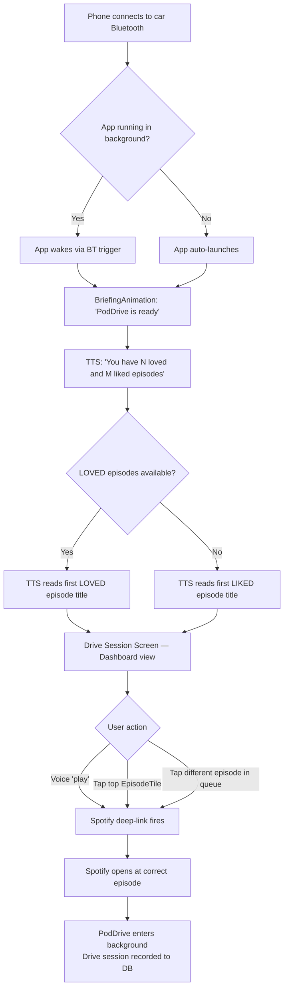
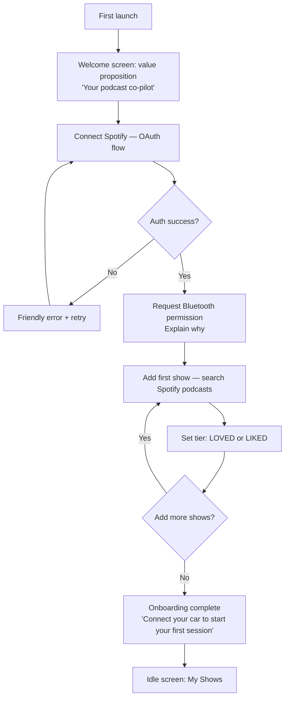
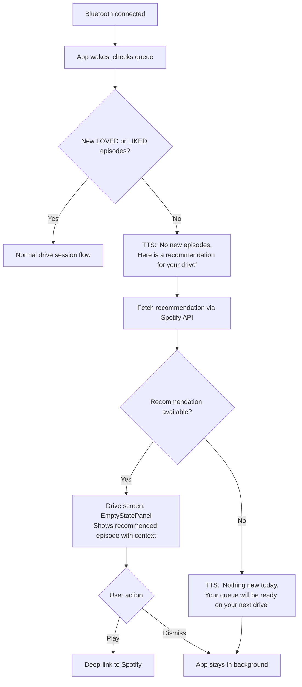
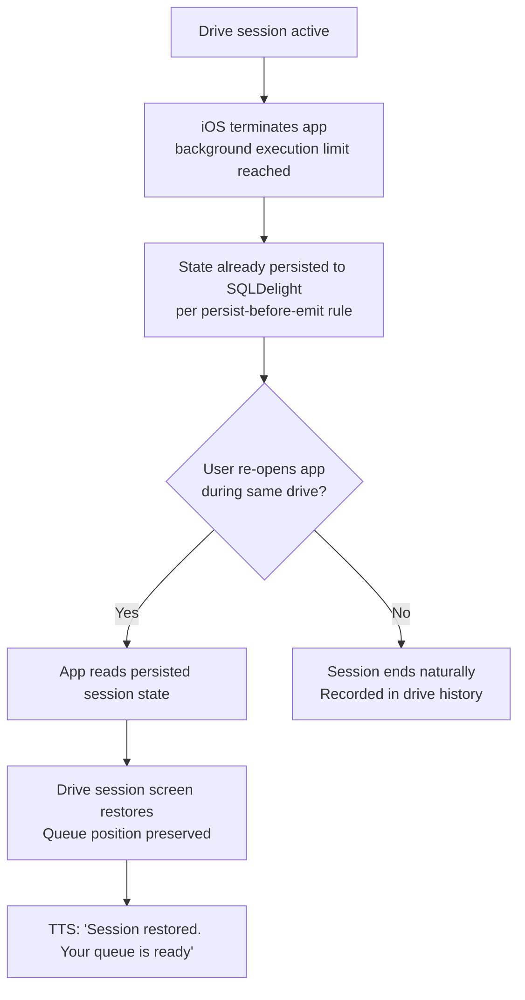

# UX Design Specification PodDrive

**Author:** Dimitrios.dimitrelos
**Date:** 2026-03-19

---

<!-- UX design content will be appended sequentially through collaborative workflow steps -->

## Executive Summary

### Project Vision

PodDrive is a mobile app (iOS + Android) that eliminates the gap between Spotify's podcast library and safe in-car listening. Its core innovation is a Bluetooth-triggered automatic activation: when the user connects to their car's audio system, PodDrive auto-starts an AI voice briefing of their unplayed episodes and hands off playback to Spotify via deep-links — requiring zero manual interaction to get started. PodDrive operates as a purposeful layer on top of Spotify's public API, not a competitor.

### Target Users

**Primary — The Daily Commuter:**
A regular podcast listener who commutes by car and is frustrated by needing to unlock their phone and navigate Spotify before or during a drive. They want their podcast queue ready the moment they connect their phone to the car. Tech-comfortable, but not a power user — they expect things to "just work."

**Secondary — The Long-Distance Driver:**
Road trippers and frequent drivers who want curated, hands-free podcast discovery across longer journeys. Values curation over volume — wants to hear the best stuff first, not scroll through a backlog.

**User profile:** Mid-to-advanced smartphone users, aged 25–45, comfortable with app integrations and voice prompts. Not likely to read documentation — the app must be self-evident from first use.

### Key Design Challenges

1. **Hands-free first** — all critical interactions (start session, choose episode, skip, pause) must be completable without touching the screen. Manual UI exists only as a secondary support layer.
2. **Glanceable safety** — when users do glance at the screen during a stop, the UI must communicate everything essential in under 2 seconds: large targets, high contrast, minimal text.
3. **Seamless Spotify handoff** — the transition from PodDrive briefing to Spotify playback must feel intentional and native, not like being ejected into a different app.
4. **Empty and error states** — graceful, voice-friendly fallbacks are essential: when no new episodes exist, when Bluetooth fails to trigger, or when iOS kills the background session.

### Design Opportunities

1. **Voice-first UX** — almost no mainstream podcast app has a genuine voice-native drive mode. This is a real differentiator and must be treated as the primary interaction paradigm, not an add-on.
2. **Emotional curation through LOVED/LIKED tiers** — the two-tier system creates a personal podcast "relationship." The UI should reinforce this warmth — LOVED shows feel special, not just filtered.
3. **Purpose-built drive context** — designing specifically for the car environment (vs. retrofitting a standard mobile UI) is the core competitive advantage. Every screen should assume the user is either driving or about to drive.

## Core User Experience

### Defining Experience

PodDrive's core experience is the "connect and go" loop: the moment a user's phone connects to their car's Bluetooth audio system, PodDrive automatically starts an AI voice briefing of their unplayed podcast queue. The user listens, chooses an episode by voice or a single tap, and Spotify opens directly to that episode. Zero per-session setup. Zero manual navigation while driving.

### Platform Strategy

**Platforms:** Native iOS (SwiftUI) and Android (Jetpack Compose) via Kotlin Multiplatform shared logic. No web companion in MVP.
**Input model:** Voice-first during drive sessions; touch UI serves as a secondary fallback and for settings/management outside the car.
**Key platform capabilities leveraged:** Bluetooth audio profile detection, on-device TTS, background audio execution, Spotify deep-link integration.
**Connectivity:** Graceful offline degradation required — cached queue data must be available without active internet.

### Effortless Interactions

- Bluetooth car connection automatically triggers drive session — no taps, no unlocking
- AI voice briefing plays immediately on connection — no reading required
- Episode selection via voice command or single tap
- Spotify opens directly to the correct episode on handoff
- Drive session state recovers silently after OS background termination

### Critical Success Moments

1. **The "it just works" moment:** First time the user connects to their car and hears their queue announced automatically — this is the trust-earning moment and the make-or-break first impression.
2. **The Spotify handoff:** Episode launches in Spotify at the correct position instantly — any friction here (wrong screen, loading delay) breaks the seamlessness promise.
3. **The empty inbox grace:** When no new LOVED/LIKED episodes exist, the app offers a smart recommendation proactively — the user never hits a dead end.

### Experience Principles

1. **Drive starts, podcast starts** — the Bluetooth connection IS the session trigger; no per-session user action required.
2. **Voice is the primary interface** — all critical decisions (play, skip, choose episode) must be completable without touching the screen.
3. **Never interrupt the drive** — errors, empty states, and Spotify handoffs must resolve gracefully without demanding user attention.
4. **LOVED always comes first** — the two-tier curation model is sacred; LOVED episodes are always surfaced before LIKED, at every decision point.

## Desired Emotional Response

### Primary Emotional Goals

**Calm Confidence** — the primary emotion: users feel their drive is taken care of before they've done anything. The app is a trusted co-pilot, not a tool they have to operate.

**Delight** — the "it just works" surprise moment when the voice briefing auto-starts on Bluetooth connection. This is PodDrive's signature emotional beat and must be consistently delivered.

**Trust** — the quiet assurance that the app always has something good queued, the Spotify handoff will work, and nothing will demand unsafe phone attention.

### Emotional Journey Mapping

| Stage | Target Emotion |
|---|---|
| First discovery (install/setup) | Curious, hopeful |
| First drive session auto-start | Surprised, delighted |
| During voice briefing | Calm, attentive |
| Episode selection | Confident, in control |
| Spotify handoff | Seamless — no emotional blip |
| Empty inbox | Reassured — never abandoned |
| Returning user | Anticipatory |
| Error/edge case | Informed but undisturbed |

### Micro-Emotions

- **Confidence over anxiety** — state must always be clear; users should never wonder if the session started
- **Warmth over utility** — LOVED podcasts feel personally chosen, not algorithmically filtered
- **Accomplishment over guilt** — completing the queue during a commute feels productive, not unsafe
- **Flow over interruption** — the entire drive session feels unbroken and continuous

### Design Implications

- *Calm confidence* → Minimal UI, large legible text, persistent status indicator, nothing unexpected
- *Delight* → Smooth Bluetooth trigger animation, warm and natural voice tone, instant audio response
- *Trust* → Consistent LOVED/LIKED hierarchy, reliable Spotify handoff, honest and graceful empty states
- *Warmth* → Heart iconography for LOVED, personal language ("Your shows"), gentle screen transitions

### Emotional Design Principles

1. **The app speaks before the user has to** — proactive voice output creates confidence that the session is running
2. **Never make the user feel unsafe** — if an interaction requires eyes-off-road attention, redesign it
3. **Warmth is a feature** — the LOVED/LIKED model is an emotional relationship; design should honour that
4. **Graceful always beats correct** — a gentle, calm error message preserves trust better than a technically accurate but disruptive one

## UX Pattern Analysis & Inspiration

### Inspiring Products Analysis

**Android Auto**
Purpose-built in-car UI that demonstrates the gold standard for drive-context design. Key strengths: large glanceable cards optimised for brief visual attention; dark background minimising glare; voice-first interaction with minimal touch fallback; implicit 2-tap maximum rule across all flows; persistent "now playing" state always visible without navigation; auto-launch behaviour on car connection. Android Auto proves that removing decision fatigue — having the car context auto-configure the right experience — is itself the product.

**Headspace**
Audio-first mobile app that treats its visual layer as ambient support rather than primary content. Key strengths: session state awareness (pre/during/post session each have distinct UI modes); warm, unhurried transitions that set emotional tone before content starts; personal language that creates a sense of relationship; visual hierarchy that defers to audio. Headspace demonstrates that an app can be deeply engaging while asking nothing of the user's eyes.

### Transferable UX Patterns

**Navigation Patterns**
- Android Auto's persistent "now playing" anchor → PodDrive's drive session screen is the single root during an active session; no deep navigation permitted while driving
- Headspace's three-state session model (before/during/after) → PodDrive has three distinct UI modes: Idle, Drive Session Active, Post-Drive Summary

**Interaction Patterns**
- Android Auto's implicit 2-tap maximum → no drive-mode action in PodDrive may require more than 2 taps from the session screen
- Android Auto's oversized touch targets (72dp+) → all drive-mode interactive elements meet this minimum
- Headspace's audio-confirms-action model → voice briefing and TTS are the primary confirmation channel; screen is secondary

**Visual Patterns**
- Android Auto's dark theme + high contrast → mandatory for drive mode screens
- Headspace's warm, muted ambient palette → informs idle and management screens outside the car context
- Headspace's breathing room in layouts → generous whitespace in PodDrive's drive screen; information density is low by design

### Anti-Patterns to Avoid

- **Multi-step flows during a drive** — Spotify's full navigation UI is the counter-example; PodDrive must never expose this complexity in drive mode
- **Small touch targets** — any interactive element below 64dp in drive mode is a safety failure
- **High-stimulation screens** — bright colours, busy layouts, or animations that demand visual attention while driving
- **Interrupting modal dialogs** — nothing may block the drive screen with a required decision
- **Visual confirmation for audio actions** — if TTS has already confirmed the action, the screen should not re-prompt

### Design Inspiration Strategy

**Adopt directly:**
- Android Auto's dark-first drive mode theme
- Android Auto's 2-tap maximum rule for all drive-mode flows
- Headspace's three-state session model adapted to: Idle / Drive Session Active / Post-Drive

**Adapt for PodDrive:**
- Android Auto's persistent now-playing bar → repurpose as a drive session status strip showing current briefing state and LOVED/LIKED count
- Headspace's pre-session calm transition → adapt as the Bluetooth trigger animation: a brief, warm "PodDrive is ready" moment before the voice briefing begins

**Avoid entirely:**
- Spotify-style multi-level navigation in any drive-context screen
- Any UI pattern requiring sustained visual focus while the vehicle is in motion

## Design System Foundation

### Design System Choice

**Platform Native + Shared Custom Token Layer**

PodDrive uses native platform UI frameworks on each target (SwiftUI on iOS, Jetpack Compose on Android via KMP) with a unified PodDrive design token layer applied as theming. Material Design 3 serves as the structural foundation on Android; Apple Human Interface Guidelines on iOS. Both platforms share the same design token specification (colour, typography, spacing, iconography) to ensure visual brand consistency.

### Rationale for Selection

- KMP architecture mandates native UI per platform; a cross-platform component library would add complexity without benefit
- Material Design 3 and SwiftUI's modifier system both accept custom token theming natively — one design spec, two implementations
- Android Auto's proven in-car UX patterns are Material Design native; staying close to M3 on Android delivers familiar drive-mode affordances
- Headspace's warmth is achieved through custom tokens, not bespoke components — this approach replicates that strategy at MVP speed
- Smallest viable custom component set minimises build time while maximising brand differentiation

### Implementation Approach

Design tokens defined once in a shared spec (JSON/YAML-compatible) and implemented as:
- `Theme.kt` (Compose MaterialTheme extensions) on Android
- `DesignTokens.swift` (SwiftUI environment values / ViewModifiers) on iOS

Platform-native standard components used for all standard UI elements (buttons, lists, navigation bars, sheets). Custom components built natively per platform from a shared visual specification.

### Customization Strategy

**Shared token set (applied on both platforms):**
- Colour palette: dark-first drive mode theme + warm ambient palette for idle screens
- Typography scale: large-legible drive mode sizes + standard sizes for management screens
- Spacing rhythm: 8dp base grid; drive-mode elements snap to 16dp/24dp multiples
- Iconography: custom PodDrive icon set (LOVED heart, LIKED thumbs, drive session, Spotify handoff arrow)

**Custom component set (built natively per platform from shared spec):**
1. `DriveSessionCard` — the central drive-mode anchor panel
2. `EpisodeTile` — large-target episode row with LOVED/LIKED tier indicator
3. `BriefingAnimation` — Bluetooth trigger visual transition
4. `EmptyStatePanel` — graceful recommendation fallback screen

## 2. Core User Experience

### 2.1 Defining Experience

> **"Connect your car, hear your podcasts."**

PodDrive's defining experience is Bluetooth-triggered automatic activation: when the user's phone connects to their car's audio system, PodDrive wakes, plays a warm transition animation, and begins a voice briefing of their unplayed podcast queue — requiring zero manual interaction to get started. The car connection IS the trigger.

### 2.2 User Mental Model

**Current state:** Users follow a manual ritual (unlock → open Spotify → find episode → tap play) that they've adapted to do before or during early drive moments. Their mental model is "I have to set this up myself."

**PodDrive's shift:** Replace that model with "it happens when I get in the car." Grounded in the already-familiar CarPlay/Android Auto auto-launch pattern — users transfer existing expectations without needing new conceptual frameworks.

**What users love about current solutions:** Spotify's catalogue depth and discovery recommendations.
**What they hate:** Manual navigation during or before driving; losing their place; missing new episodes.

### 2.3 Success Criteria

- Voice briefing starts within 5 seconds of Bluetooth connection
- Episode selection completable in ≤2 taps or 1 voice command from the drive session screen
- Zero visual attention required to complete a drive session start end-to-end
- Silent, automatic recovery if iOS terminates the background session mid-drive

### 2.4 Novel UX Patterns

| Interaction | Type | Teaching Approach |
|---|---|---|
| Bluetooth auto-trigger | Novel | Grounded in CarPlay/Android Auto metaphor; onboarding explains once |
| Voice briefing of queue | Novel | Natural extension of familiar podcast title-reading; no education needed |
| Episode tile list + play | Established | Standard list → tap → action pattern; no education needed |
| Spotify deep-link handoff | Novel-ish | Familiar "Open in app" pattern; brief loading state communicates intent |

### 2.5 Experience Mechanics

**Initiation:** Bluetooth audio profile connected → app wakes from background → `BriefingAnimation` plays (brief warm "PodDrive is ready" transition) → TTS begins queue summary briefing.

**Interaction:** User listens to briefing. `DriveSessionCard` displays LOVED/LIKED episode count and top episode name. User selects via voice command ("play") or single tap on top `EpisodeTile`.

**Feedback:** TTS confirms selection ("Opening [Episode Title] in Spotify"). Screen shows brief "Handing off..." state on `DriveSessionCard`. Spotify deep-link fires.

**Completion:** Spotify opens at the correct episode. PodDrive enters background. Drive session recorded in local database. User is listening within ~3 seconds of selection.

## Visual Design Foundation

### Color System

PodDrive uses a dual-context dark colour strategy. Both Drive Mode and Idle/Management screens use dark backgrounds for visual consistency — aligned with Android Auto and Spotify conventions. Warm amber is the primary accent; coral rose and sky blue differentiate LOVED and LIKED tiers using both colour and iconography.

| Token | Value | Usage |
|---|---|---|
| `color-bg-drive` | `#0F0F12` | Drive session screen background |
| `color-surface-drive` | `#1C1C24` | DriveSessionCard, panels |
| `color-surface-elevated` | `#272736` | Episode tiles, sheet backgrounds |
| `color-bg-idle` | `#18181B` | Idle / management screens |
| `color-surface-idle` | `#27272A` | Cards in management screens |
| `color-accent` | `#F59E0B` | Primary actions, Bluetooth trigger glow, active briefing state |
| `color-loved` | `#F87171` | LOVED tier badge, heart icon, LOVED episode highlight |
| `color-liked` | `#60A5FA` | LIKED tier badge, thumbs icon |
| `color-handoff` | `#34D399` | Spotify handoff state indicator |
| `color-text-primary` | `#F9FAFB` | Primary text, episode titles |
| `color-text-secondary` | `#9CA3AF` | Podcast names, subtitles |
| `color-text-tertiary` | `#6B7280` | Captions, timestamps |
| `color-error` | `#F87171` | Error states, connection failures |

### Typography System

Platform system fonts used throughout (SF Pro on iOS, Roboto on Android). Two scales: Drive Mode (large/glanceable) and Standard.

| Role | Size | Weight | Usage |
|---|---|---|---|
| Drive Count | 48sp | Bold | LOVED/LIKED episode count |
| Drive Display | 28sp | Semibold | Current episode title in drive session |
| Drive Subhead | 18sp | Regular | Podcast name, briefing status |
| Drive Status | 13sp | Medium, +0.5 tracking | Session state labels |
| H1 | 24sp | Semibold | Screen titles |
| H2 | 20sp | Semibold | Section headers |
| Body | 14sp | Regular | Descriptions, list content |
| Caption | 12sp | Regular | Timestamps, metadata |

### Spacing & Layout Foundation

- **Base grid:** 8dp
- **Drive mode spacing:** 16/24/32dp multiples — generous, uncluttered
- **Touch targets:** 64dp minimum (drive mode); 44dp minimum (management)
- **Drive layout:** Single-column, full-width cards, bottom-heavy for thumb zone
- **Management layout:** Standard list/card, 16dp horizontal margins

### Accessibility Considerations

- All drive-mode text combinations meet WCAG AAA (7:1+ contrast ratio)
- LOVED/LIKED differentiation uses colour AND distinct iconography (heart vs. thumbs) — never colour alone
- TTS voice briefing is the primary accessibility affordance for drive mode
- Dynamic Type / font scaling supported via platform system fonts
- Drive mode touch targets exceed Apple HIG (44dp) and Material Design (48dp) minimums

## Design Direction Decision

### Design Directions Explored

Three directions were explored via an interactive HTML showcase (`ux-design-directions.html`):
1. **Minimal Focus** — single hero card, maximum whitespace, count as primary element
2. **Dashboard** — two-zone layout with briefing animation and visible episode queue ✅ Selected
3. **Ambient** — atmospheric glows, frosted glass card, Headspace-inspired warmth

### Chosen Direction

**Direction 2 — Dashboard**

A structured two-zone drive session screen: live briefing animation and status at top, scrollable episode queue below. Single full-width Spotify CTA anchored at the bottom. Tier filter tabs (All / Loved / Liked) on the idle/management screen.

### Design Rationale

- The visible episode queue removes uncertainty — users can confirm what will play before committing
- The waveform animation makes the briefing feel actively alive, reinforcing the "co-pilot" emotional goal
- Stats strip (Loved / Liked / Total) provides the glanceable count at a safe visual density
- Tier filter tabs on the idle screen make the LOVED/LIKED management model immediately legible
- The layout satisfies the 2-tap maximum rule while providing more context than a minimal single-card approach

### Implementation Approach

- Drive screen: top zone (briefing status + waveform + stats strip) is fixed; bottom zone (episode queue) scrolls
- Queue items use `EpisodeTile` component with tier colour dot indicator (❤️ coral / 👍 blue)
- Bottom CTA always anchored — never scrolls out of reach
- Idle screen: tier filter tabs map directly to the LOVED/LIKED data model
- All interactive targets in drive zone meet 64dp minimum

## User Journey Flows

### Journey 1 — Core Drive Session (Happy Path)

The primary flow — Bluetooth connection to Spotify playback with zero required user action.

### Journey 2 — First-Time Onboarding

One-time setup that earns user trust before the first drive session.

### Journey 3 — Empty Inbox / Recommendation Fallback

Graceful handling when no new episodes exist — never a dead end.

### Journey 4 — Session Recovery (iOS Background Termination)

Silent, automatic recovery — user should never notice it happened.

### Journey Patterns

- **Entry pattern:** Bluetooth event is always the drive-mode trigger — no manual "start session" action
- **TTS-first feedback:** Every state change is announced via voice before the screen updates
- **2-tap maximum:** No journey requires more than 2 taps from session screen to Spotify playback
- **Graceful fallback chain:** LOVED → LIKED → Recommendation → Calm dismissal — never a hard stop
- **Persist-before-emit:** State is written to DB before any UI update — recovery is always possible

### Flow Optimisation Principles

1. Voice confirms before screen updates — audio is always faster than visual for driving context
2. The episode queue is visible on the drive screen so users can make a confident choice without navigating
3. Empty states proactively offer an alternative — they never just say "nothing here"
4. Onboarding front-loads trust: Spotify connection and Bluetooth permission are explained with clear rationale, not demanded silently

## Component Strategy

### Design System Components

Platform-native components used without customisation (M3 on Android / SwiftUI on iOS):

| Component | Usage in PodDrive |
|---|---|
| Button (primary/text) | "Play in Spotify" CTA, settings actions |
| SearchBar / TextField | Show search during onboarding |
| LazyColumn / List | Episode queue, show management |
| NavigationBar / TabBar | Shows / Discover / Settings navigation |
| ModalBottomSheet / Sheet | Episode detail, tier picker |
| CircularProgressIndicator / ProgressView | Spotify handoff loading state |
| OAuth WebView | Spotify authentication |
| System permission dialogs | Bluetooth + notification permissions |
| Snackbar / Toast | Error and confirmation feedback |

### Custom Components

#### `DriveSessionCard`
**Purpose:** Fixed top zone of the drive session screen — always visible, never scrolls.
**Anatomy:** Bluetooth status pill → waveform animation → stats strip (Loved N / Liked N / Total N)
**States:** `BRIEFING_ACTIVE` (waveform animates, amber glow) | `BRIEFING_COMPLETE` (static, "Ready to play") | `HANDING_OFF` (spinner, `color-handoff` tint) | `ERROR` (red pill, retry action)
**Accessibility:** All state changes announced via TTS; error retry button meets 64dp touch target

#### `EpisodeTile`
**Purpose:** Single episode row — primary selection target in drive mode.
**Anatomy:** Queue position | TierBadge | Episode title (1–2 lines) | Show name + duration | Chevron
**States:** `DEFAULT` | `FIRST` (amber border highlight) | `PRESSED` (surface-elevated flash)
**Variants:** Drive (64dp height, 28sp title) | Standard (52dp height, 14sp title)
**Accessibility:** Content description: "[Tier] episode: [title] from [show], [duration]"
**Interaction:** Single tap → fires Spotify deep-link

#### `BriefingAnimation`
**Purpose:** Transitional moment between Bluetooth connection and briefing start — PodDrive's signature beat.
**Anatomy:** Full-screen overlay → wordmark → animated waveform → fades to DriveSessionCard
**States:** `ENTERING` → `ACTIVE` (waveform pulses with TTS) → `EXITING`
**Duration:** ~1.2s enter; persists during TTS briefing; exits on user action
**Accessibility:** Decorative overlay — does not block TTS; tap anywhere to skip

#### `EmptyStatePanel`
**Purpose:** Graceful empty inbox fallback — replaces episode queue when no new episodes exist.
**Anatomy:** Illustration | Headline | Recommended episode card | Play button | Dismiss link
**States:** `WITH_RECOMMENDATION` | `NO_RECOMMENDATION` (calm dismissal only)
**Accessibility:** TTS reads headline and recommendation title automatically on enter

#### `TierBadge`
**Purpose:** Compact, reusable tier indicator used across EpisodeTile, ShowTile, and queue headers.
**Variants:** `FULL` (icon + label, 10sp pill) | `ICON_ONLY` (8dp coloured dot)
**Colours:** `color-loved` (#F87171) / `color-liked` (#60A5FA) with 13% opacity background
**Accessibility:** Never colour-only — always includes icon; content description: "Loved podcast" / "Liked podcast"

#### `TierFilterTabs`
**Purpose:** Filter strip on idle screen — switches between All / Loved / Liked views.
**Anatomy:** Three pill-shaped tabs in horizontal row
**States:** `SELECTED` (filled background) | `UNSELECTED` (ghost)
**Accessibility:** Role = TabList; each tab announces selection state

#### `ShowTile`
**Purpose:** Podcast entry in the management screen show list.
**Anatomy:** Artwork (52dp rounded square) | Show name | New episode count | TierBadge | Long-press menu trigger
**States:** `HAS_NEW_EPISODES` (full opacity) | `NO_NEW_EPISODES` (60% opacity)
**Long-press:** Bottom sheet with tier change and remove options
**Accessibility:** Content description: "[Show name], [N] new episodes, [tier]"

### Component Implementation Strategy

- All custom components built natively per platform (Compose on Android, SwiftUI on iOS) from a shared visual specification
- Custom components consume shared design tokens via `Theme.kt` (Android) and `DesignTokens.swift` (iOS)
- `TierBadge` is the most reused component — implement first and ensure it is fully accessible before integrating elsewhere
- Drive-mode variants of components enforce 64dp touch targets regardless of content size

### Implementation Roadmap

**Phase 1 — Core (MVP drive session):**
- `BriefingAnimation` — gates the entire drive experience
- `DriveSessionCard` — fixed anchor of the drive screen
- `EpisodeTile` (Drive variant) — primary episode selection
- `TierBadge` (ICON_ONLY) — used inside EpisodeTile

**Phase 2 — Supporting (complete MVP):**
- `EmptyStatePanel` — empty inbox graceful handling
- `ShowTile` — idle management screen
- `TierFilterTabs` — show list filtering
- `TierBadge` (FULL) — ShowTile and EmptyStatePanel contexts

**Phase 3 — Enhancement (post-MVP polish):**
- `EpisodeTile` (Standard variant) — non-drive episode browsing
- `DriveSessionCard` HANDING_OFF animation refinement
- `BriefingAnimation` waveform sync with live TTS audio

## UX Consistency Patterns

### Button Hierarchy

**Drive mode** (64dp minimum touch targets):
- Primary: Full-width amber filled — "Open in Spotify" — one per screen, bottom-anchored
- Secondary: Ghost/outlined (48dp) — skip, dismiss
- Icon-only: 64dp circular — always paired with TTS content description
- Rule: Never more than one primary button visible simultaneously

**Management mode** (44dp minimum):
- Primary: Filled amber — "Add Show", "Save"
- Secondary: Outlined — "Cancel", "Remove"
- Text: No container — inline links, "See all"

### Feedback Patterns

**TTS-first rule:** In drive mode, every state change announces via TTS before the screen updates.

| Situation | TTS Announcement | Screen Response |
|---|---|---|
| Session starts | "PodDrive is ready. You have N loved episodes." | BriefingAnimation → DriveSessionCard |
| Episode selected | "Opening [title] in Spotify." | HANDING_OFF state |
| Session restored | "Session restored. Your queue is ready." | Drive screen with preserved queue |
| Empty inbox | "No new episodes. Here is a recommendation." | EmptyStatePanel |
| Error | "Could not connect. Tap to retry." | ERROR state on DriveSessionCard |

Management mode: M3 Snackbar / system toast for confirmations. Destructive actions use bottom sheet confirmation, never an alert dialog.

### Navigation Patterns

**Drive Session — locked navigation:**
- Back gesture / system back suppressed during active drive session
- Bottom navigation hidden — drive screen is the only UI context
- Session ends via Bluetooth disconnect or long-press "End Session" on DriveSessionCard

**Management mode — standard navigation:**
- Persistent bottom navigation: Shows | Discover | Settings
- Deep navigation uses bottom sheets (not full-screen push) to preserve context
- Back stack follows platform conventions

### Modal and Overlay Patterns

- Bottom sheet: tier picker, episode detail, show options — partial height, drag to dismiss
- Full-screen overlay: `BriefingAnimation` only
- No AlertDialog for non-destructive actions — reserve native dialogs for system permission prompts only

### Empty States and Loading States

**Spotify handoff loading:** `DriveSessionCard` HANDING_OFF state + TTS confirmation. 3s timeout → ERROR state with retry.

**Queue fetch loading:** BriefingAnimation plays immediately; 3 skeleton EpisodeTile rows while fetching — never a blank list flash.

**Empty show list:** Illustration + "Add your first show to get started" + primary "Add Show" CTA.

### Search and Filtering Patterns

**Show search:** Debounced 300ms. Results show artwork + name + episode count. Tier selected inline before adding. Already-added shows display check indicator.

**Tier filter tabs:** Stateless per session (resets to "All" on relaunch). Filtered view animates in (fade + slide). Empty filtered state shows contextual prompt with shortcut to add.

## Responsive Design & Accessibility

### Responsive Strategy

PodDrive targets mobile phones as the primary form factor (MVP). No desktop or web target. Tablet support is graceful degradation only (single-column centred layout, max-width 480dp).

### Breakpoint Strategy

| Breakpoint | Width | Adaptation |
|---|---|---|
| Compact | < 400dp | Drive Count 40sp; 12dp outer padding |
| Standard | 400–599dp | Designed layout; 16dp outer padding |
| Medium | 600–839dp | Single-column centred, max-width 480dp |
| Expanded | 840dp+ | Letter-boxed at 480dp max-width |

### Accessibility Strategy

**Target: WCAG 2.1 AA** (drive mode colour tokens exceed AAA).

| Requirement | PodDrive Specification |
|---|---|
| Text contrast | ≥7:1 on all drive-mode text; ≥4.5:1 management |
| Touch targets | 64dp minimum (drive mode); 44dp minimum (management) |
| Text resize | `sp` units throughout; containers expand with content |
| Non-text contrast | All UI components ≥3:1 |
| Colour independence | LOVED/LIKED conveyed by icon + colour + label — never colour alone |

**Screen reader:** Full TalkBack (Android) and VoiceOver (iOS) support. TTS briefing suppresses overlapping screen reader announcements during drive sessions. Focus order: DriveSessionCard → EpisodeTiles → CTA.

**Reduce Motion:** `BriefingAnimation` respects system Reduce Motion setting — skips waveform animation, shows static state. TTS briefing unaffected.

**Dynamic Type:** All text uses `sp` / Dynamic Type categories. Tested at 150% and 200% font scale each release.

### Testing Strategy

**Device matrix (minimum):** iPhone SE 3rd gen, iPhone 14, Pixel 4a, Pixel 7, Samsung Galaxy Tab A.

**Accessibility testing per release:**
- TalkBack + VoiceOver full navigation pass on all screens
- 200% font scale layout check
- Reduce Motion check on BriefingAnimation
- Colour blindness simulation (deuteranopia + protanopia)

**Automated:** `AccessibilityChecks.enable()` in Espresso (Android); Xcode Accessibility Inspector audit (iOS).

### Implementation Guidelines

- Use `sp` for all text sizes; `dp` for spacing and touch targets
- Never hardcode text container heights — always expand with content
- All custom components implement `contentDescription` / `.accessibilityLabel`
- Drive-mode touch targets enforced at component level — not relying on padding
- `BriefingAnimation` checks reduced-motion preference before playing
- Test every screen at compact breakpoint (360dp) before marking complete
